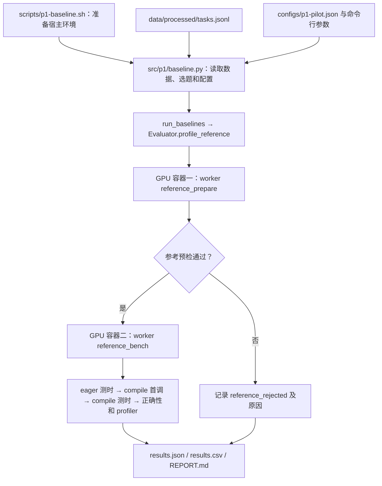

# P1 基线：当前方案与运行说明

更新日期：2026-11-03。服务器项目根目录：`/home/likun/junjxu/CUDA-Agent`。

本文整合当前的数据、模型、工具、评测协议及运行方法。模型正确率、加速比和成本等实际结果，以接下来新建运行目录中的输出为准。

## 1. P1 要测什么

P1 测量原始 Qwen3.5-9B 在 CUDA 代码生成上的起点，尚不更新模型权重。vLLM 负责推理；verl、PPO、RFT 和价值模型训练不参与本阶段执行。评测奖励只作为反馈和记录。

需要区分两个维度：

| 维度 | 方式 | 含义 |
|---|---|---|
| 原始计算程序怎样执行 | eager | 原始 PyTorch 模型直接执行 |
| 原始计算程序怎样执行 | torch.compile | 同一模型经 `torch.compile(mode='default')` 编译后执行 |
| 语言模型怎样生成候选 | single | 一次生成完整源码，不获得执行反馈 |
| 语言模型怎样生成候选 | agent | 使用工具读取文件、分析性能、编译验证并迭代修改 |

单独测量 eager/compile 无需加载 Qwen。运行模型 pilot 时，每个预检通过的任务分别执行 single 和 agent，候选实现都与该任务的 eager/compile 基线比较。

## 2. 数据、划分与 pilot

数据使用作者发布的 CUDA-Agent-Ops-6K，固定 revision 为 `44a734c78c947bfcba5189cbfd13f57a6d29a698`。原始文件为 `data/raw/ops6k.parquet`，SHA256 为 `d4404fc181cad72081f8c1cba720cc1b511fb34dee924079e898bf1e83f6257c`。

每题包含 PyTorch `Model`、构造模型参数的 `get_init_inputs` 和构造输入的 `get_inputs`。这些代码定义参考计算，不是配有专家 CUDA 答案的监督样本。

数据处理去除文档字符串及 AST 位置信息，以规范化源码哈希形成任务组；同组不会跨集合。这不是完整的语义去重。当前按 `data_source` 分层，用 seed=42 的确定性哈希顺序划分 train/test，比例约 8:2；没有 dev/holdout，也不按历史 pilot 题目调整归属。

| 集合 | 原始行数 | 任务组数 |
|---|---:|---:|
| train | 4803 | 4434 |
| test | 1197 | 1108 |
| 合计 | 6000 | 5542 |

比例按任务组计算，重复组大小不同，所以不将原始行强拆成恰好 4800/1200。pilot 仅从 train 中确定性抽取 12 个不重复任务组，保存在 `data/processed/pilot.json`；test 留给配置冻结后的正式评测。

数据文件职责：

| 文件 | 内容 |
|---|---|
| `data/processed/tasks.jsonl` | 全部任务及其 train/test 归属 |
| `data/processed/train.jsonl` | train 中的全部数据行 |
| `data/processed/test.jsonl` | test 中的全部数据行 |
| `data/processed/pilot.json` | 当前从 train 抽取的 12 题 |
| `reports/p1/data-audit.json` | 数据来源指纹、行数/组数、划分计数、接口审计、pilot ID 及相似性审计摘要 |

`data-audit.json` 由 `src/p1/data.py` 的 `prepare()` 调用 `dump()` 自动生成，不是实验结果，也不需要手工维护。执行以下命令会重新生成上述数据及审计，并额外写出 `reports/p1/kernelbench-similarity.json` 的逐题源码相似性记录；只运行 CPU 数据处理。

```bash
cd /home/likun/junjxu/CUDA-Agent
conda activate .runtime/conda/learner
# 处理原始数据，生成划分、train pilot 和审计文件，不启动模型或 GPU。
PYTHONPATH=src python -B -m p1.data
```

确定性排序内部保留固定哈希盐，使清理元数据不会改变现有题目归属。

KernelBench 固定提交为 `423217d9fda91e0c2d67e4a43bf62f96f6d104f1`，L1/L2/L3 共 100/100/50 题。数据处理使用 AST 类型/名称三元组 Jaccard 做源码相似性筛查；目前没有规范化源码精确重复，但这不证明语义无重合或预训练无污染，也不等同于论文的 PythonASTSimilarity 方法。数据处理不会运行 KernelBench GPU 评测。

## 3. 模型与运行环境

主模型为官方 `Qwen/Qwen3.5-9B` 的固定 revision `c202236235762e1c871ad0ccb60c8ee5ba337b9a`，本地目录为 `models/Qwen3.5-9B`。配置没有 `quantization_config`；权重文件头中有 727 个 BF16 张量及 48 个 F32 张量，属于以 BF16 为主的原始浮点 checkpoint，不是 INT4/INT8、AWQ/GPTQ 量化版本。

BF16 描述语言模型权重与推理精度，不会将参考计算任务的输入统一转为 BF16。

| 组件 | 当前用途或来源 |
|---|---|
| `.runtime/conda/learner` | 宿主机上的模型推理与评测控制器 |
| `.runtime/conda/kernel` | 容器内使用的 Python、PyTorch 和 Ninja；只读挂载 |
| `/usr/local/cuda-12.9` | CUDA Toolkit 12.9；只读挂载到容器 |
| 当前配置 GPU [4,5] | Qwen 模型生成；generation_gpu 可填整数或编号列表 |
| 当前配置 GPU [6,7] | 参考与候选验证、测时；evaluation_gpu 可填整数或编号列表 |
| `third_party/verl` | 后续训练使用的源码；P1 不调用 |

当前目标为 A100 sm_80，PyTorch 为 2.11+cu129；硬件和软件条件不同于论文的 H20 验证池。

### Docker 的作用

沿用服务器已有的自定义镜像 `rpent-vla-env:libero-pro`，固定 image ID 为 `sha256:d58d23b33e24c351dffc6b1bda93dcd7925e3832e2770da6b65e10abfdd05fa0`。它不是 CUDA-Agent 官方专用镜像。

镜像提供 Ubuntu 22.04.5、Bash、常用命令、GCC/G++ 11.4、glibc 2.35 及系统库。项目将自己的 kernel Conda 和 CUDA Toolkit 挂载进去；实际 Python/Ninja 来自 Conda，nvcc 来自挂载的 CUDA 12.9。GPU 驱动由宿主机通过 NVIDIA 容器运行时提供。

开发容器保存一条轨迹内的工作区和 Bash 状态，不提供 GPU、网络或 Docker socket。GPU 评测由宿主控制器向独立容器派发，参考代码、工具和环境只读挂载，可写目录和资源受限。Conda 管理依赖，Docker 提供受限执行边界。

镜像继承的 `CUDA_VERSION=12.6.3`、`VIRTUAL_ENV=/workspace/.venv-vla` 和启动脚本不代表当前调用了旧 Python 或旧 nvcc，但仍可能影响依赖这些设置的工具；系统编译器、动态库搜索路径和 ABI 也会影响兼容性。开发容器覆盖镜像入口，评测容器仍继承入口。固定 image ID 防止标签漂移，但单独复制镜像不足以复现宿主挂载的全部环境。

Docker 客户端为 `/usr/bin/docker`，Docker 管理数据根目录为 `/data2/docker`；当前使用 containerd image store，其 root 为 `/data2/containerd`。这些全局存储位置与项目内 Conda 环境的位置不同。

## 4. 当前模型生成配置

配置来源为 `configs/p1-pilot.json`。下表按文件顺序列出当前全部 38 个字段。
2026-11-05 当前配置采用固定生成 seed、1×10 稳态测时及候选之后的参考基线；不再设置基线漂移门槛。GPU 与并发值按当前配置同步，历史实验仍以各自 manifest 为准。本次修复详见第 22 节。

| 字段 | 当前值 | 含义及生效方式 |
|---|---|---|
| `seed` | `42` | 数据抽样及每次模型生成的固定种子；不叠加题号或轮次。CUDA 验算输入沿用另一组固定且彼此不同的种子。 |
| `pilot_tasks` | `12` | 数据准备时从 train 抽取的 pilot 题数；运行时 --task-id 可进一步选子集。 |
| `model` | `"models/Qwen3.5-9B"` | 项目根目录下的原生 Qwen3.5-9B 模型目录，使用 BF16 权重推理。 |
| `model_revision` | `"c202236235762e1c871ad0ccb60c8ee5ba337b9a"` | 模型来源版本追溯信息，不会在启动时联网下载。 |
| `dataset_revision` | `"44a734c78c947bfcba5189cbfd13f57a6d29a698"` | Ops-6K 数据来源版本追溯信息。 |
| `kernelbench_revision` | `"423217d9fda91e0c2d67e4a43bf62f96f6d104f1"` | KernelBench 来源版本追溯信息，不自动运行 KernelBench。 |
| `generation_gpu` | `[0,7]` | 宿主生成卡编号或列表；每卡一个完整模型副本，同卡多个题共享该引擎，非张量并行。 |
| `evaluation_gpu` | `[4,5]` | 宿主评测卡编号或列表；不与生成卡重合。正确性检查可同卡并发，正式性能测时独占。 |
| `docker_image` | `"sha256:d58d23b33e24c351dffc6b1bda93dcd7925e3832e2770da6b65e10abfdd05fa0"` | 固定评测镜像的内容摘要；模型在宿主 learner 中推理，隔离执行在该镜像内进行。 |
| `context_tokens` | `131072` | Agent 总上下文窗口及引擎 max_model_len；含提示、历史、工具反馈和新输出。 |
| `generation_tokens` | `null` | 每次输出的额外 token 上限；null 表示只受当轮剩余窗口限制。 |
| `tool_feedback_tokens` | `null` | 工具反馈额外 token 上限；null 不额外截断，工具自身日志摘要仍有边界。 |
| `temperature` | `0.7` | 模型采样温度；本地选择，论文未公开相同数值。 |
| `top_p` | `0.95` | 核采样阈值；本地选择，论文未公开相同数值。 |
| `max_turns` | `200` | Agent 最多生成轮数，不是最多工具调用数。 |
| `trajectory_seconds` | `null` | 整条轨迹的累计墙钟预算；null 不设置此额外上限。 |
| `compile_seconds` | `300` | 每次 CPU 编译容器超时，单位秒；不包含等待编译槽的时间。 |
| `evaluation_seconds` | `120` | 反馈阶段流式检查容器的总超时，单位秒；显式设置 300 秒的参考预检/测时不变。 |
| `hidden_evaluation_seconds` | `600` | 隐藏流式验算容器总超时，单位秒；控制器另留 5 秒收尾。 |
| `atol` | `0.01` | 数值比较绝对容差；与 rtol 一起判断，未因分块比较而放宽。 |
| `rtol` | `0.01` | 数值比较相对容差；要求 abs(候选−参考) ≤ atol + rtol×abs(参考)。 |
| `timing_iterations` | `10` | 每轮稳态测量执行次数；预热后轮换输入。 |
| `timing_rounds` | `1` | 稳态测量轮数；轮内及轮间均取中位数。 |
| `feedback_cases` | `5` | 搜索反馈输入数；当前 5 次比较。 |
| `hidden_cases_per_init` | `5` | 每个初始化的隐藏基础输入数；当前 5×2×3+4=34 次比较。 |
| `hidden_init_seeds` | `[73001,73002]` | 隐藏检查的参数初始化种子，区别于语言模型采样种子。 |
| `case_storage_limit_bytes` | `8589934592` | 单个在途输出文件上限；同题全部参数快照另以该值限制总量。双输出通道按两倍预算协作预留空间；不限制 GPU 显存，也不是宿主目录配额。 |
| `protocol_version` | `"p1-paper-aligned-v4"` | manifest 中的追溯标识；字符串不自动切换评测逻辑，不代表论文全部复现。 |
| `train_ratio` | `0.8` | 数据准备时的 train 比例，按规范化源码任务组划分；test 留作正式评测。 |
| `pilot_split` | `"train"` | pilot 来源划分；当前为 train。 |
| `single_context_tokens` | `32768` | single 总上下文窗口；含提示和一次输出，不额外补写格式失败的答案。 |
| `shell_seconds` | `600` | 持久 Shell 命令硬上限；Bash 的前台等待 timeout 与此不同，等待结束可返回 bash_id。 |
| `candidate_selection` | `"best_correct_speedup_compile"` | 当前固定候选选择策略的记录标签；正确且测时有效的候选按 compile 加速比排序，再做隐藏验收。 |
| `generation_concurrency` | `4` | 每张生成卡同时推进的独立题数；支持统一正整数或按 GPU 编号的字典。无固定两题上限；同卡共享权重与动态批处理。 |
| `evaluation_concurrency` | `4` | 每张评测卡最多同时运行的正确性检查作业数；支持正整数或逐卡字典。每个作业含参考/候选两个隔离容器，显存需求应一并考虑。正式性能测时不使用共享槽。 |
| `compile_workers` | `4` | 全项目同时允许的 CPU 编译作业数，正整数；编译不占用评测卡。 |
| `enable_prefix_caching` | `true` | 是否启用生成引擎的公共提示前缀 KV 缓存；不缓存候选输出或隐藏答案。已通过本机双请求验证。 |
| `enforce_eager` | `false` | true 强制模型推理 eager；false 允许 vLLM torch.compile/CUDA Graph。只作用于生成模型，不改变被测 PyTorch eager/compile 基线。 |

`thinking` 在生成代码中固定开启。single/Agent 窗口借用论文公开设置；temperature/top_p 为本地参数，不是同条件复刻。并发批次及推理后端改变可能使采样文本变化，即使基础 seed 相同也不能宣称与旧运行逐 token 一致。

## 5. 从输入到结果的流程

1. **保存题单并预检参考任务。** 新运行读取当前 `pilot.json`，复制为该 run 的 `tasks.json`，记录配置、源码哈希及硬件快照。检查参考任务的可运行性、容差范围内的重复一致性和有限值；不再筛除近常数题。预检无效题单独记录，不按模型成败换题；因此 12 题不保证全部进入两种模型模式。
2. **准备工作区。** 放置只读的 `model.py`、上游 `SKILL.md`、固定 `binding.cpp` 和 `binding_registry.h`，候选编写 `model_new.py` 与 `kernels` 下的 CUDA/C++ 源码。模型构造器、参数层级和 `state_dict` 必须兼容参考模型。
3. **模型生成。** single 一次输出 `<file path="…">` / `</file>` 原始源码文件块；agent 先分析原始性能，再使用文件和 Shell 工具开发、编译、验证和优化。
4. **源码快照与实现合同。** 每次评测复制候选源码、记录哈希，检查路径、固定文件和实现约束。主要计算要求 raw CUDA，允许 cuBLAS GEMM、cuDNN 卷积；Python 仅承担分配、元数据和扩展调用，不允许 PyTorch 计算回退、`torch.compile`、Triton、精度状态修改或输出缓存投机。
5. **编译与搜索反馈。** 用 nvcc 和 PyTorch 扩展构建工具面向 sm_80 编译。参考与候选在独立容器中重建相同输入和参数，严格加载 `state_dict`。外部控制器比较结构、shape、dtype、有限值及逐元素误差；搜索反馈使用 5 个输入，`atol=rtol=0.01`。
6. **性能与奖励。** 正确候选才进入性能比较。先测候选，再在同一张卡上测 eager 和 compile；只用这组后测基线计算加速比与奖励。不做前后平均或漂移拒绝/重试；零值、非有限或非正耗时仍不产生速度奖励。
7. **选择最终候选。** 搜索候选与最终工作区一起参与选择；按相对 compile 的有效速度降序排列，源码去重后逐个隐藏验收，返回最快合格项。没有合格项则记录失败。
8. **隐藏检查与汇总。** 隐藏验收使用 2 组初始化、每组 5 个输入，并检查重复调用、同地址内容变化、调用顺序及参数重载；隐藏结果不反馈给模型继续优化。记录最终正确性、有效速度、生成 token、累计 prefill token、工具调用和时间成本。

### 工具与持久 Shell

`src/p1/tools.py` 提供 Bash/BashOutput/KillBash、Read/Write、Edit/MultiEdit、Glob/Grep、NotebookEdit、TodoWrite，以及 evaluate、profile_reference、submit。Grep 调用真正的 ripgrep，支持文件类型过滤和上下文行；相对路径与 `/workspace/...` 映射到同一工作区。文件修改实行先读后写，MultiEdit 全部匹配后才一次写入。

每条 Agent 轨迹保留同一个 CPU 开发容器及 Bash 进程，跨调用保持 cwd、export、函数、工作区和 `/tmp`；轨迹之间不共享会话。Shell 超时会关闭该会话。

兼容层 `src/p1/agent_utils` 只读挂载为开发容器中的 `/workspace/utils`，提供与上游 SKILL 对应的命令：

```bash
# 先分析参考程序的 eager/compile 性能，不要求已有候选。
python3 -m utils.profiling --reference-only
# 编译当前候选；成功时将扩展发布到开发工作区。
bash utils/compile.sh
# 对当前候选执行五例反馈验证。
python3 -m utils.verification
# 候选存在时先验证，再测时和分析性能。
python3 -m utils.profiling
```

这些命令通过受限请求通道让宿主执行固定评测动作；开发容器不能提交任意宿主路径或命令。正式验收运行冻结源码，只复用控制器按同一源码和构建环境产生并校验哈希的缓存；不信任工作区已有的 `.so`。

静态检查会跟踪 `forward` 调用的辅助方法，区分 `at::ArrayRef`、Tensor 等类型和真正的计算调用；仅导入 F 不等于执行 F.relu。未知 C++ 符号给出人工审查提示，候选 profiler 另检查运行期 ATen 计算回退。这些机制仍不能证明零误拒或零漏检。

## 6. 精度、计时与结果解释

参考、compile 和候选使用相同 kernel 环境与评测 GPU，matmul/cuDNN 的 TF32 均开启并检查前后状态。TF32 允许使用更快的计算路径，不代表所有 FP32 输入转成 BF16；严格 FP32 审计是另一个实验条件。

性能测量先预热，轮换 5 组输入，每轮 30 次、共 3 轮，记录 CUDA event 和同步墙钟，以中位数汇总。输入克隆不计入执行区间；编译首调和稳态执行分开记录。首调可能命中缓存，不能直接称为冷编译时间。

加速比为“基线耗时 / 候选耗时”，大于 1 表示更快。离散奖励为：失败 -1；正确但未达到速度门槛为 1；比 eager 耗时下降超过 5% 为 2；同时比 eager 和 compile 耗时下降超过 5% 为 3。5% 时间下降对应候选耗时小于基线的 0.95 倍。

没有正确且测时有效的候选时，不报告有效候选加速比，几何平均加速比为 `null`，不是 0 倍。基础设施故障、参考任务无效、输出格式/实现合同问题和候选数值错误需要分开解释。累计 prefill 会重复处理对话历史，不等于相同数量的不重复文本；轨迹墙钟也不等于纯 GPU 计算时间。

## 7. 亲自运行

### 7.1 仅测 eager/torch.compile

```bash
cd /home/likun/junjxu/CUDA-Agent
# 列出 train 中排序后的前 12 个任务，不启动 GPU。
bash scripts/p1-baseline.sh --list --split train --limit 12
# 预览测量任务和 GPU 编号，不启动 GPU。
bash scripts/p1-baseline.sh --dry-run --split train --limit 1 --gpu 3
# 实际测量 train 中排序后的第一题，使用 GPU 3；不加载 Qwen。
bash scripts/p1-baseline.sh --split train --limit 1 --gpu 3
```

baseline 入口默认创建带时间戳的独立目录。这里的 `--limit 12` 是排序后的前 12 个 train 任务，不等同于模型 pilot 的 12 题；需要指定题目时使用 `--task-id`。

### 7.2 运行 Qwen single/agent pilot

启动脚本会加载 Conda 并激活 learner，无需额外 activate.sh。先确认配置指定的所有卡可用（默认生成 2、评测 3）；控制器会逐卡检查显存占用，超过 100 MiB 时拒绝启动，并要求项目所在文件系统至少有 80 GiB 可用空间。

```bash
cd /home/likun/junjxu/CUDA-Agent
# 启动当前 train pilot，GPU 2 生成、GPU 3 评测；该命令会执行真实实验。
bash scripts/p1-run.sh --run runs/p1/pilot-train-v4-seed42
```

首次运行使用新的输出目录。已有 manifest 的目录需要显式 `--resume`，且保存配置必须与当前配置完全一致；恢复时使用该 run 自己保存的题单。运行过程中不要修改其配置、源码或题单。

```bash
conda activate /.runtime/conda/learner
# 明确指定本次新 run，避免状态工具采用历史默认路径。
PYTHONPATH=src python -B -m p1.status --run runs/p1/pilot-train-v4-seed42
```

上述示例仅说明操作方式；本次文档整理未替用户执行 GPU 命令，也不自动启动定时跟进、完整 test、KernelBench 或 P2 训练。

## 8. 输出文件与检查方法

| 位置 | 内容 |
|---|---|
| 模型 run 的 `tasks.json` | 本次实际使用的固定题单 |
| 模型 run 的 `manifest.json` | 配置、任务 ID、源码哈希、硬件快照和运行状态 |
| 模型 run 的 `references/` | 参考任务预检、基线与相关日志 |
| 模型 run 的 `trajectories/` | single/agent 生成文本、工具反馈、工作区、逐轨迹结果和成本 |
| 模型 run 的 `evaluations/` | 候选快照、编译日志、逐例检查、性能与隐藏验收 |
| 模型 run 的 `results.json` | 持续更新的完成结果及已记录的无效任务 |
| 模型 run 的 `summary.json` | 整个 pilot 正常结束后的分模式汇总 |
| baseline run 的 `results.json`、`results.csv`、`REPORT.md` | eager/compile 时间、加速比、首调时间和汇总说明 |

查看结果时先检查参考任务有效性，再检查候选正确性、测时有效性及速度，最后分析成本和失败类别。任务被预检隔离、轨迹中断或整个流程未正常结束时，要明确相应分母及缺失结果；不能仅凭 `summary.json` 是否存在判断已完成轨迹是否保存。

## 9. 与原论文的对应及边界

依据：[论文 CUDA Agent](https://arxiv.org/abs/2602.24286)及[公开仓库](https://github.com/BytedTsinghua-SIA/CUDA-Agent)，项目引用的上游快照为 `473025c8af7878e928525138b5cb327d6bcdf9dd`。

| 项目 | 论文披露 | 当前 P1 |
|---|---|---|
| 基座模型 | Seed1.6，230B 总参数/23B 激活参数 | 用户指定 Qwen3.5-9B，架构和规模不同 |
| 单轮窗口 | 单轮 RL 为 32768 | single 使用该窗口数字，不声称论文披露了相同的单轮推理输出上限 |
| Agent 窗口 / turn 上限 | 131072 / 200 | 窗口/turn 配置相同；真实流程已运行，模型与训练条件仍不同 |
| 单次 4096 token、整条 30 分钟 | 未找到足以复刻的明确依据 | 不设置这两个额外默认上限；保留单次操作超时 |
| temperature/top_p | 未找到足以完全复刻的数值 | 本地使用 0.7/0.95 |
| 开发工具 | 持久 Bash、文件工具、SKILL 等 | 提供对应 CUDA 任务工具和 utils 兼容命令；不等同于完整 OpenHands 系统 |
| 原始性能分析 | 先分析参考程序瓶颈 | profile_reference 与 --reference-only 支持 |
| 候选选择 | 轨迹中对 compile 最快的正确解 | 按速度排序、去重并隐藏验收后选择 |
| 正确性 | 搜索阶段五例反馈 | 五例反馈，另加本地隐藏检查及状态审计 |
| 奖励 | -1/1/2/3 及 5% 时间下降门槛 | 采用对应里程碑；不更新权重 |
| 性能统计 | 重复测量、平均等论文条件 | 本地采用 1×10 次测量的中位数；只用候选之后的参考基线，无漂移门槛 |
| 数据与硬件 | 论文训练流程、KernelBench 250 题、H20 验证池 | train pilot、A100、torch2.11+cu129 |
| 训练 | 单轮 PPO、RFT/价值预训练、Agentic PPO | P1 不训练 |

论文的单轮训练阶段及 w/o Agent Loop 消融，不等同于未训练 Qwen 的 single/agent 本地对照。当前 P1 不能直接检验论文完整 RL 流程的效果，也不能将小 pilot 的结果视为 KernelBench 主表复现。

## 10. 验证与代码职责

当前实现已完成 CPU 协议回归和无 GPU 容器接口检查；这些验证不替代新版真实模型、隐藏验收与性能路径的 GPU 集成验证。后续以实际运行证据更新结论。

```bash
conda .runtime/conda/learner
# 在项目根目录运行 CPU 回归，不加载模型或使用 GPU。
PYTHONPATH=src python -B -m unittest discover -s tests/p1 -v
# 检查持久容器和 utils 请求通道；使用 CPU Docker 与假评测回复。
PYTHONPATH=src python -B tests/p1/sandbox_smoke.py
```

`src` 保存可复用实现，`scripts` 保存环境和启动入口，`tests` 保存回归与集成测试，`runs` 保存每次实验的原始证据，`reports` 保存当前说明和数据审计。自有脚本、函数和关键流程有中文注释；`scripts` 下每条命令的用途写在其紧邻上一行。`gpu_*.py` 是需显式运行的 GPU 测试，不会因导入测试模块而自动启动实验。


## 11. p1-baseline 的数据、配置、代码与运行全过程

本节沿当前代码逐步说明 `p1-baseline` 的真实执行路径。下面的命令是运行示例，撰写本节时没有执行 GPU 实验。

### 11.1 先明确：这次究竟测什么

`p1-baseline` 回答的是：**对于同一段 PyTorch 计算，直接执行 eager，与使用 torch.compile 后执行，各需要多长时间？**

这里每个任务的 `Model` 是一个计算程序，例如矩阵乘法、卷积或一串算子的组合，不是 Qwen 语言模型。两种方式执行同一任务，使用同一组模型参数和输入；编译后还要检查输出是否与 eager 一致。

这条入口不加载 Qwen，不使用 vLLM 或 verl，不让 Agent 写源码，不运行自定义候选 CUDA 的编译和隐藏验收。它建立的是后续候选优化要比较的两个参考起点。

整体调用关系如下：



两个容器按顺序使用同一张评测 GPU，不是同时占两张卡。每题走完后才处理下一题。

### 11.2 哪些数据和文件会被读取

| 文件或目录 | 本入口的用途 |
|---|---|
| `scripts/p1-baseline.sh` | 启动入口，激活 learner、设置路径并把参数交给 Python |
| `scripts/set-env.sh` | 提供 CUDA、线程、缓存和临时目录的公共环境设置 |
| `src/p1/baseline.py` | 解析参数、读取任务、选题、检查 GPU、调度逐题测量并汇总 |
| `src/p1/data.py` | 被导入以取得项目根目录 `ROOT` 和 JSON 写入函数 `dump`；本次不会自动执行其中的数据生成程序 |
| `data/processed/tasks.jsonl` | 实际读取的任务全集，包含源码和 train/test 归属 |
| `configs/p1-pilot.json` | 读取公共配置，选中的 GPU 等运行设置会传给容器 |
| `src/p1/evaluation.py` | 准备参考任务、创建容器、传递配置和文件、收集结果 |
| `src/p1/worker.py` | 在容器内实际执行参考预检、torch.compile、GPU 测时和 profiler |
| `.runtime/conda/learner` | 宿主控制器使用的 Python 环境 |
| `.runtime/conda/kernel` | 容器内实际运行 PyTorch 的 Python 环境，只读挂载 |
| `/usr/local/cuda-12.9` | 容器使用的 CUDA Toolkit，只读挂载 |
| 配置指定的 Docker 镜像 | 提供容器的 Linux 用户空间和系统工具 |

`data/processed/tasks.jsonl` 的每行是一条 JSON 记录，主要字段如下：

| 字段 | 用途 |
|---|---|
| `code` | 真正执行的 Python 源码，包含 Model/get_init_inputs/get_inputs |
| `task_id` | 规范化源码组对应的任务标识，用于去重、选题及输出目录命名 |
| `split` | train 或 test；供 `--split` 筛选 |
| `ops` | 算子名称标签，用于列题展示；具体计算以 code 为准 |
| `data_source`、`row_index` | 记录数据来源及原始行号 |
| `source_hash`、`normalized_hash` | 辅助追溯源码和分组 |

这些记录此前由 `src/p1/data.py::prepare()` 从 `data/raw/ops6k.parquet` 生成。**实际跑 baseline 时，不会重新读取 Parquet、重新划分数据或重新抽 pilot。**

本入口也不读取 `train.jsonl`、`test.jsonl`、`pilot.json`、`reports/p1/data-audit.json`，而是从 `tasks.jsonl` 的 split 字段中筛选。刚补齐的 `upstream/CUDA-Agent/agent_workdir` 官方示例及其 utils、binding、kernels，也不参与这条入口；当前调用的是本项目自己的控制器和 worker。

### 11.3 启动脚本先做什么，为什么需要两个 Conda 环境

例如执行：

```bash
# 在服务器项目根目录启动一题真实基线测量，使用 GPU 3。
bash /home/likun/junjxu/CUDA-Agent/scripts/p1-baseline.sh --split train --limit 1 --gpu 3
```

启动脚本依次做以下事情：

1. 开启 Bash 严格模式并切换到固定项目根目录，使命令失败及时退出、相对路径保持一致。
2. 加载 `/data2/likun/miniconda/etc/profile.d/conda.sh`，激活项目 `.runtime/conda/learner`。
3. source 公共 `set-env.sh`，设置 CUDA_HOME、PATH、缓存目录和线程等环境变量。这里只设置变量，不会初始化 CUDA 或开始计算。
4. 把宿主 `CUDA_VISIBLE_DEVICES` 覆盖为空。公共脚本中的 P0 默认 GPU 4 不会用于本次计算；真正的 GPU 由后面 Docker 的 `--gpus device=3` 指定。
5. 将项目 src 加入 PYTHONPATH，执行 `python -B -m p1.baseline "$@"`。`-B` 禁止写入 pyc，`"$@"` 保留原始命令行参数。

learner 在宿主负责文件和容器调度；kernel 在容器中负责实际 PyTorch/GPU 运算。宿主会导入一些 PyTorch 辅助代码，但其 GPU 可见性为空，不进行本次 GPU 计算。Docker 管执行边界，Conda 管 Python 依赖，它们承担不同职责。

公共脚本还包含 Hugging Face、vLLM 等变量，但这些变量的存在不会使 baseline 自动加载语言模型。容器另行设置自己的 PATH、缓存和临时目录，部分值会覆盖宿主设置。

### 11.4 如何选题：--limit 与 pilot_tasks 不是一回事

`baseline.main()` 读取 `tasks.jsonl` 后，调用 `select_tasks()`：

1. 按 `--split` 过滤，默认 train。
2. 用 task_id 去重，因此同一源码组不会因为包含多条原始行而重复测量。
3. 按 task_id 的字典顺序排序。
4. 未指定 ID 时取前 `--limit` 个，默认只取 1 个；显式指定 `--task-id` 时，返回指定的全部 ID，`--limit` 不再截断它们。
5. 如果某个指定 ID 不属于所选 split，直接报错，避免悄悄换题。

因此，`--limit 12` 表示“排序后的前 12 个 train 任务”，不是配置中的 12 道模型 pilot，也不是随机抽样。配置中的 `pilot_tasks` 和 `pilot_split` 在这里不参与选题。

当前排序第一题为 `ops6k-00192d5b7124134b`，参考计算是：

```python
# 对每个矩阵保留上三角部分。
x = torch.triu(x, diagonal=0)
# 沿 dim=1 做 logsumexp，得到参考输出。
return torch.logsumexp(x, dim=1, keepdim=False)
```

该题的输入形状由 get_inputs 定义，为 `[512, 1024, 128]`，输出为 `[512, 128]`。输入的形状、dtype 和计算内容来自题目源码，不会因为语言模型使用 BF16 而统一改成 BF16。

三个运行分支要分清：

| 参数 | 做到哪一步 | 是否使用 GPU/创建实验输出目录 |
|---|---|---|
| `--list` | 选题并打印 ID/ops，随后返回，甚至不读取公共配置 JSON | 否 |
| `--dry-run` | 选题、读配置、应用 --gpu 覆盖并打印选中 ID/评测 GPU | 否；也不会核验 GPU 当前是否空闲 |
| 不带上述参数 | 检查指定卡后创建目录并执行；新运行不传卡号时默认 GPU 7 | 是 |

### 11.5 配置实际如何生效

真实运行中，`--gpu 3` 会把读入内存的 `evaluation_gpu` 改为 3，不会修改磁盘上的 `p1-pilot.json`。多卡可使用 `--gpus 2,3`，各评测器独立持有实际卡号，共用同一份只读 `worker-config.json`。调用 nvidia-smi 检查指定卡的显存使用，沿用当前代码中用户设置的 60000 MiB 阈值；不会结束已有进程。该阈值不能证明 GPU 空闲，正式测时仍应选择无其他任务干扰的卡。新增文件锁只协调同项目新版基线控制器，无法阻止其他程序使用 GPU。

| 配置或代码设置 | 在 baseline 中的实际作用 |
|---|---|
| `evaluation_gpu` | 单卡用 --gpu 选择；多卡用 --gpus 列表分配；新运行不传时保留入口默认 GPU 7 |
| `docker_image` | 选择已存在的固定镜像；--pull=never 不自动拉取 |
| `atol=0.01`、`rtol=0.01` | 参考重复输出稳定性检查、候选与参考输出比较的浮点容差 |
| `feedback_cases=5` | 基线测时轮换的输入数，也是 compiled/eager 比较的案例数 |
| `hidden_init_seeds=[73001,73002]` | 本入口仅在参考预检中额外构造这两组参数，并保存参数快照 |
| `hidden_cases_per_init=5` | 预检会记录其对应的隐藏案例计数，但本入口不执行这些隐藏候选比较 |
| `timing_iterations=30` | 每轮稳态测量的执行次数 |
| `timing_rounds=3` | 稳态测量轮数，采用两级中位数汇总 |
| `evaluation_seconds=120` | 是容器公共默认超时；本 baseline 路径显式传入 300 秒，覆盖该默认值 |
| `compile_seconds=300` | 用于候选扩展编译；此处不是控制 torch.compile 首调的字段 |
| `baseline_drift_limit=0.03` | 用于候选前后基线漂移审核；独立 baseline 不执行这一套前后复测 |
| `seed=42` | 影响此前的数据处理；参考预检和测时输入使用 worker 内固定的种子，不能靠改这个值切换本次所有测试输入 |
| model/revision、生成 GPU、上下文、采样、turn/Shell、候选选择等字段 | 随整个配置保存到 manifest，但不会在此入口触发对应的模型或 Agent 功能 |

当前参考预检与参考测量各有一个**代码中显式写定的 300 秒容器超时**，不是两个阶段合计 300 秒。只修改 `evaluation_seconds` 或 `compile_seconds` 不会改变这两个显式参数。

### 11.6 新建输出目录并准备参考任务

GPU 检查通过后，`run_baselines()` 新建输出目录。默认形如 `runs/p1/baseline-<时间戳>`，显式使用北京时间 UTC+8；也可用 `--run` 指定目录。目录已存在时拒绝覆盖，需要通过 `--resume --run <目录>` 显式恢复。续跑从原 manifest 读题单和配置，不重新按当前 --limit 选题，详见第 12 节。

控制器先写出：

- `worker-config.json`：各卡共享的只读 worker 配置，由主控制器在线程启动前写一次，单卡/多卡均保持原文件名。实际卡号由宿主的 `Evaluator.gpu` 单独传给 Docker。
- `manifest.json`：记录 mode=reference_only、完整配置、所选 task_ids，以及 loads_qwen=false。

然后逐题调用 `Evaluator.profile_reference(task)`。新目录没有该题的参考快照，因此进入 `Evaluator.prepare(task)`：

1. 将 tasks.jsonl 中的 code 写为该 run 的 `references/<task_id>/model.py`。这不是上游示例 model.py，而是本次选定任务的原始代码。
2. 启动 `reference_prepare` 容器，检查参考计算并保存初始化参数。
3. 如果预检合格，再启动 `reference_bench` 容器进行 eager/compile 测量。

新 baseline 每题通常只调用一次这条路径；预检通过后使用初始测量结果，不会无故重复完整测量。共享函数 profile_reference 虽支持后续复用参数并重新测时，但 CLI 本次不会主动循环重复调用同一题。

### 11.7 Docker 具体带进去什么

容器通过 kernel 环境 Python 执行 `/worker.py reference_prepare` 或 `/worker.py reference_bench`，并使用 `-I -B`：隔离 Python 的用户环境路径并禁止写入 pyc。

| 宿主内容 | 容器中的位置/权限 | 用途 |
|---|---|---|
| `.runtime/conda/kernel` | 同一绝对路径，只读 | 实际 Python、PyTorch、Ninja 等依赖 |
| `/usr/local/cuda-12.9` | 同一路径，只读 | CUDA Toolkit |
| `src/p1/worker.py` | `/worker.py`，只读 | 当前项目的执行代码 |
| run 的 worker-config.json | `/config.json`，只读 | 各卡共用的评测参数；实际设备由 Docker --gpus 单独指定 |
| 该题 references 目录 | `/reference`，只读 | 参考源码和已有文件 |
| 该阶段的输出目录 | `/outputs`，可写 | 结果、日志、参数快照 |
| cases/input-spec（测量阶段） | `/inputs`，只读 | 重建模型和输入所需的源码及参数 |
| 该题 compile-cache（测量阶段） | `/refcache`，可写 | TorchInductor/Triton 编译缓存 |

容器没有网络，根文件系统只读，临时目录使用 tmpfs，CPU 配额为 4、系统内存限制为 24 GiB。这里的 24 GiB 不是 GPU 显存上限。只向容器提供指定编号的 GPU；容器内看到的 cuda:0 可以对应宿主的 GPU 3。worker 另记录 GPU UUID 用于溯源，选择设备仍按编号。

镜像提供系统工具和库，实际 torch 来自挂载的 kernel Conda。测量结束后容器被删除，挂载到宿主 run 中的结果和编译缓存保留。

### 11.8 第一个 GPU 容器：参考预检和参数保存

`worker.main()` 先统一环境：matmul/cuDNN TF32 均开启、cuDNN benchmark 关闭、PyTorch CPU 线程数设为 4。随后 `worker.prepare(cfg)`：

1. 加载 `/reference/model.py`，从中取得 Model、get_init_inputs、get_inputs。
2. 分别使用初始化种子 71001、73001、73002，同步 Python、NumPy、PyTorch 和 CUDA 随机源。
3. 每个种子下构造 `Model(*get_init_inputs()).eval().cuda()`，仅保存 CPU state_dict；后续按同一初始化种子，从只读参考模块的 get_init_inputs() 重建构造参数，再严格加载权重。无可训练参数的任务可以有空 state_dict，这不代表任务不合法。
4. 对输入种子 72000、72001 分别生成输入，把同一输入复制后执行两次参考程序，检查重复结果一致及浮点输出有限值。
5. 采样输出元素并记录 shape/dtype/numel 等统计，检查不同输入及初始化下是否都近似同一个常数。

为什么这样做：先确认参考程序本身可以作为可靠测量对象；固定并保存参数，避免下一容器重新初始化出不同权重；保存参考输出审计摘要；合法近常数任务不再因此被排除。

重复一致性检查在各自初始化内进行，不要求不同初始化的输出彼此相等；浮点使用配置容差。近常数启发式筛查已移除。

输出的 input-spec 包含参考源码和 `state-71001.pt`、`state-73001.pt`、`state-73002.pt`。后续测时使用 71001 这一组参数；另外两组用于本次预检及共享评测流程的准备，不会自动执行候选隐藏验收。

如果参考容器报错或超时，控制器保存原因并把该题记为 reference_rejected，跳过性能结果。这个状态可能来自预检，也可能来自后续初始基线测量失败，不能仅凭状态名断言数据源码有错。

### 11.9 第二个 GPU 容器：eager 与 compile 测量

此时进入 `worker.bench(cfg, candidate=False)`，过程如下：

**第一步，重建相同模型与输入。** 从 input-spec 加载 Model，使用保存的初始化参数构造实例，再严格加载 state_dict。按输入种子 72000 至 72004 生成 5 组输入，输入由 get_inputs 决定。所有 forward 均在 eval 和 no_grad 下执行，不计算训练梯度。

**第二步，测 eager。** 直接调用 Model。先用 5 组输入各预热一次并同步，再做 3 轮、每轮 30 次测量；每次轮换输入并先克隆、同步，随后开始计时。

每次测量同时记录两种时间：

| 时间 | 计时范围与用途 |
|---|---|
| CUDA event ms | GPU stream 上记录的事件间隔，用于比较设备执行耗时；不等于 profiler 中所有 kernel 时间的简单求和 |
| 同步墙钟 ms | CPU 开始调用至 GPU 同步完成的时间，包含 Python/调度及同步等开销 |

输入克隆发生在这两个计时区间之前。两种时间都先对每轮 30 次取中位数，再对 3 个轮中位数取中位数。每种模式共记录 90 次正式执行，预热、首调、正确性比较及 profiler 的执行另计。

**第三步，创建编译版本并记录首调。** 调用 `torch.compile(model, mode='default')`，执行第一组输入并等待 GPU 完成，记录 compile_first_call_seconds。这里可能包含首次编译、加载和第一次执行，因此单独保存，不混入之后的稳态时间；也不能保证是完全无缓存的冷编译。

**第四步，测 compile 稳态。** 对 compiled 执行与 eager 相同的五组输入预热、1 轮×10 次测量和中位数汇总。编译优化由 PyTorch 完成，可能生成或调用 CUDA/Triton 等内核；这不是 Agent 生成的候选。候选禁止 Triton 的实现合同不会施加到 torch.compile 参考基线上。

**第五步，明确基线用途。** 按官方 profiling.py，compile 仅提供性能参考，不再额外比较 compiled 与 eager 输出，也不生成 compile_correct 字段。候选实现仍须通过与原始 eager 输出的独立正确性检查；基线编译/运行异常及无效测时仍按原规则处理。

**第六步，另做性能分析。** 分别对 eager、compile 的第一组输入运行一次 profiler，记录调用名、调用次数和 device_us 等统计。profiler 在正式计时之后独立运行，其耗时不混入稳态结果。名称和占比有助于解释是否存在融合、调度或大算子瓶颈，但一次采样不足以证明完整性能原因。

**第七步，记录 TF32 状态并返回。** worker 保存 TF32 前后状态、state_mutations、两种耗时、编译首调时间和 profiles。compile 可能包含图中断或回退，当前代码未强制 fullgraph；compile 成功不等于所有算子被融合为一个 kernel。

### 11.10 结果如何落盘，先看哪些文件

一次成功的单题运行，主要目录结构如下。下面以项目下 `runs/p1/baseline-<时间>/` 为根：

```text
baseline-<时间>/
├── manifest.json                 # 本次模式、配置、task_count、题单；明确不加载 Qwen
├── worker-config.json            # 各卡共用的只读配置，单卡/多卡均保留此名称
├── results.json                  # 首条记录为 MEAN，后续为各题摘要及 detail_path
├── results.csv                   # 保留表头，首个数据行为 MEAN，逐题更新
├── REPORT.md                     # 表格首个数据行为 MEAN，含拒绝原因，逐题更新
└── references/<task_id>/
    ├── model.py                  # 从本次 JSON 任务记录导出的参考源码
    ├── preflight.json            # 仅保存状态及阶段结果路径
    ├── cases/
    │   ├── worker.log            # 第一个容器的标准输出和错误
    │   ├── prepare_result.json   # 完整预检结果，含 controller_seconds
    │   └── input-spec/
    │       ├── model.py          # 用于后续模型和输入重建的源码
    │       └── state-*.pt        # 各初始化种子的参数快照
    ├── initial-bench/
    │   ├── worker.log            # 第二个容器的标准输出和错误
    │   └── bench_result.json     # 完整测时结果，含 controller_seconds
    └── compile-cache/
        ├── inductor/            # TorchInductor 缓存（按实际生成）
        └── triton/              # Triton 缓存（按实际生成）
```

`preflight.json` 的结构示例：

```json
{
  "status": "ok",
  "prepare_result_path": "references/<task_id>/cases/prepare_result.json",
  "bench_result_path": "references/<task_id>/initial-bench/bench_result.json"
}
```

上述路径以及根目录 `results.json` 的 `detail_path` 都相对于本次 run 根目录。
参考预检未通过时不会生成测时结果，也不会写入 `bench_result_path`；拒绝原因在预检详情文件中。若初始测时本身失败，仍保留 `bench_result_path` 指向失败记录。
根目录不再嵌套完整 `detail`；成功题的详情路径指向 `bench_result.json`，拒绝题指向 `preflight.json`。
Agent run 的根目录 `results.json` 同样只保留各题/模式的标量摘要和轨迹详情路径；完整轨迹结果仍在 `trajectories/<task_id>/<mode>/result.json`。
各次额外参考测时（profile、候选之后的基线）的阶段文件也统一使用 `bench_result.json`。
这些约定只用于后续运行，本次不迁移或删除已有 runs 结果。

JSON 中关键性能字段：

| 字段 | 怎么理解 |
|---|---|
| `status` | 先判断是否 ok；否则沿 detail_path 阅读详情和逐阶段日志 |
| `eager_cuda_ms` / `compile_cuda_ms` | 两种执行方式的稳态 CUDA event 耗时，毫秒 |
| `eager_wall_ms` / `compile_wall_ms` | 两种执行方式的同步墙钟耗时，毫秒 |
| `compile_over_eager_speedup` | eager_cuda_ms ÷ compile_cuda_ms；大于 1 表示 compile 更快 |
| `compile_first_call_seconds`（详情文件） | 编译包装及首调耗时，秒，注意与 ms 的单位区别 |
| `profiles`（详情文件） | eager/compile 的算子或事件统计，device_us 使用微秒 |
| `tf32_before/after`、`state_mutations`（详情文件） | 精度状态记录 |
| `controller_seconds`（详情文件） | 该测量容器从启动至收尾的控制器墙钟时间，不是单次 kernel 时间 |

例如 eager=2 ms、compile=1 ms，则加速比为 2；这是解释字段的假设数字，不是实测结果。若 compile=3 ms，加速比约 0.67，表示该配置下 compiled 更慢，不代表计时必然有错。

worker 以 JSON 返回的错误通常会被汇总后继续处理后面的任务；宿主发生未捕获异常仍可能终止整个程序。运行中优先看终端逐题结果与 results.json，CSV/REPORT 与 JSON 每完成一题共同更新；尚未完成首题时，MEAN 记录的已处理数为 0。阶段日志仍可独立查看。

baseline 不生成模型 pilot 的 summary.json，也没有 Agent 轨迹；不要用模型 pilot 的状态汇总口径解读它。

### 11.11 你可以按什么顺序亲自运行

```bash
# 切换到项目根目录。
cd /home/likun/junjxu/CUDA-Agent
# 只确认将要运行的第一道 train 任务，不使用 GPU。
bash scripts/p1-baseline.sh --list --split train --limit 1
# 只预览题目及 GPU 选择，不检查 GPU 占用、不创建运行目录。
bash scripts/p1-baseline.sh --dry-run --split train --limit 1 --gpu 3
# 实际跑这一题；先不指定 --run，让程序创建新的默认时间戳目录。
bash scripts/p1-baseline.sh --split train --limit 1 --gpu 3
```

确认单题结果、编译正确性和日志符合预期后，可自己选择扩展数量。以下两种选题方式是独立示例，按需要选择执行：

```bash
# 实际测量按 ID 排序后的前 12 道 train 任务，生成新的默认运行目录。
bash scripts/p1-baseline.sh --split train --limit 12 --gpu 3
# 或显式选择某道 train 题，使用一个尚不存在的自定义目录。
bash scripts/p1-baseline.sh --task-id ops6k-00192d5b7124134b --gpu 3 --run runs/p1/baseline-manual-one
```

`--task-id` 可以重复传入以指定多题。当前只核查了流程和代码，没有代你执行以上真实测量命令。

### 11.12 这条入口的结论边界

- 独立 baseline 不执行候选生成、隐藏验收和速度奖励；候选评测现已取消前后基线漂移审核。
- 当前 baseline 汇总主要按 worker 的 status 取数，记录的 TF32 状态变化也没有在该入口额外统一转为失败；完整的非正/非有限时间和状态审核主要位于候选评测路径。因此解读结果时仍应检查详细时间和精度状态，不能仅见 status=ok 就视为覆盖所有测量有效性条件。
- 预检、时钟、编译缓存及 PyTorch 版本都会影响测量；本次只测选定任务和当前机器，不代表全部 train/test 的平均水平。
- 这次结果可以告诉你原始 PyTorch 和自动编译优化的性能起点，不能据此评估 Qwen 的 CUDA 编程能力或论文 RL 的提升。

### 11.13 均值与样本数量

`manifest.json` 在 `task_ids` 前写入 `task_count`，表示本次选中的去重任务数，包含后续被拒绝的题。
`results.json` 首条记录为 `task_id="MEAN"`；CSV 和 Markdown 保留表头，首个数据行为均值。
均值行的 `sample_count`、`valid_sample_count`、`rejected_sample_count` 分别表示已处理、成功、未通过的样本数，不将 MEAN 本身算作样本。
每个数值指标只对成功样本中实际存在的有限数值计算算术均值，缺失、NaN、Inf 和拒绝样本不补零；无有效数据时 JSON 使用 null，CSV 留空，Markdown 使用 —。
各题加速比的算术均值不等于 eager 平均耗时除以 compile 平均耗时；此处按逐题加速比求均值。
除原有五项耗时/加速指标外，摘要补充 `compile_first_call_seconds` 和 `controller_seconds`，与稳态毫秒耗时区分。
拒绝样本保留 `detail_path`，并增加 `rejection_stage`、`rejection_reason`；REPORT 的拒绝表可追踪各阶段证据。
`reference_rejected` 是当前控制器的统一状态，可能是非有限输出，也可能是环境显存不足、输入/参数设备混用、安全反序列化或比较器异常，不能都理解为题目本身无效。

## 12. 纯基线的断点续跑与多卡执行

本节对应 `src/p1/baseline.py`、`src/p1/helper/baseline_state.py` 的调度与持久化扩展，不修改参考输入、容差、编译方式或测时轮数，不启动 Qwen/Agent。未自动停止、恢复或重跑已有实验，也未修改旧运行的中间结果。

### 12.1 怎么运行

```bash
cd /home/likun/junjxu/CUDA-Agent
# 新建多卡运行；示例卡号需要先确认空闲，每张卡独立处理一题。
bash scripts/p1-baseline.sh --split train --limit 100 --gpus 2,3 --run runs/p1/baseline-multi
# 只读预览：查看固定题单、可复用数量和待处理数量，不启动或查询 GPU。
bash scripts/p1-baseline.sh --resume --run runs/p1/baseline-multi --gpus 2,3 --dry-run
# 继续原目录剩余题目；也可只指定 --gpu 7 进行单卡续跑。
bash scripts/p1-baseline.sh --resume --run runs/p1/baseline-multi --gpus 2,3
```

`--gpu` 和 `--gpus` 互斥；仅接受非负数字编号，不能重复。新运行不指定时保留 GPU 7 默认值。恢复不指定时使用原 manifest 的 `evaluation_gpu`，并不自动沿用此前多卡列表；建议恢复时明确传卡号。`--resume` 必须配合 `--run`，不能再传 `--split/--limit/--task-id`，防止把另一批题混进旧目录。

对于 `runs/p1/baseline-20261025T223047` 这类由旧代码启动的运行，必须先让旧进程结束或自行停止，再使用同一目录的 `--resume`；当前仍在运行的旧进程不会动态获得新能力。只读预览可以在原运行期间执行。

### 12.2 怎么判断“已完成”，为什么不会重测

续跑先验证原 manifest：纯基线模式、原题单及顺序、原配置；卡号可换，其余配置保持不变。新运行额外保存各题源码/split 指纹及 worker、评测器、合同检查代码的指纹，发生变化时拒绝混合结果。旧 manifest 没有历史指纹，只能核对现存 `model.py` 与当前任务源码；首次恢复才补存当前指纹，不能反向证明旧运行完整的历史环境和代码身份。

随后读取每题的正式阶段文件和预检索引，而非仅凭根 `results.json` 或 `input-spec` 目录存在判断：

| 文件 | 恢复时检查什么 |
|---|---|
| `references/<id>/preflight.json` | 状态是否为终态，阶段路径是否确实属于本题标准路径 |
| `cases/prepare_result.json` | 完整 JSON、预检状态、输出审计摘要、控制器补写的 controller_seconds |
| `initial-bench/bench_result.json` | 需要测时时是否存在完整终态记录、控制器收尾和原有数值字段 |
| 根 `results.json/CSV/REPORT.md` | 根据正式阶段详情重建；汇总丢失或截断不导致完整题重新运行 |

成功、预检拒绝和已记录的测时失败/超时均算已完成，默认都跳过。恢复不会暗中重试拒绝题；若想另测此类题，显式新建 run。只有未完成或文件损坏的题才会重做：先将该题整个参考目录移至 `interrupted/<北京时间-随机后缀>/<id>/`，保留日志和编译缓存证据，然后从原始预检重新执行，避免残缺参数快照被误复用。归档中的中断成本不计入最终成功样本的性能均值。

### 12.3 多卡具体并行什么

主控制器维护同一份固定题单，每张指定卡最多执行一题；一题内仍按“参考预检 → eager/compile 测量”顺序执行，两种模式的性能来自同一张卡。某卡先结束就领取下一题，因此是动态分配，避免难题让静态分片一直拖尾。每个题目的源码、参数、日志与编译缓存目录独立；各卡共用同一份 `worker-config.json`，由主控制器在线程启动前写一次，各评测器只读挂载，不按卡号反复覆写。

实际卡号保存在各宿主评测器的 `gpu` 属性中，由 Docker `--gpus device=编号` 选择。worker 不读取 `evaluation_gpu` 来选卡；公共 JSON 里的该字段保留原单卡默认值，实际多卡列表以 `manifest.execution.gpus` 为准，每条结果中的 `evaluation_gpu` 记录真正执行卡号。多卡续跑不会将原 `worker-config.json` 改名，也不生成按卡拆分的配置文件。

汇总只由主控制线程写入，按原题单顺序排列，与任务完成先后无关；JSON 首行及 CSV/Markdown 首数据行仍为 MEAN。逐题摘要和阶段详情记录 `evaluation_gpu`，便于核对来源；旧阶段缺少此字段时按旧单卡 manifest 的卡号补记。每次完成一题后更新三种汇总及 manifest 的执行进度，不生成额外的逐题 checkpoint JSON 副本。

这不是单个算子分布式计算，也不是 torch DataParallel。增加卡数会同时增加 CPU、宿主内存和编译压力；每个活动容器原有的 4 CPU/24 GiB 宿主内存限制仍保留，不能承诺线性加速。跨卡测量还受型号、频率、温度及其他任务影响；选相同型号且无外部负载的 GPU，保留卡号后再解读整体均值。

### 12.4 中途停止、写盘及锁保护

新版入口捕获 Ctrl+C/SIGINT 和发给控制器 PID 的 SIGTERM：停止派发新题，等待每张卡正在做的题完成并保存后退出，退出码 130；原队列中尚未启动的题保持待处理。Docker 客户端使用独立进程会话，防止前台 Ctrl+C 直接打断当前容器并被误记为题目错误。每题可能仍需完成两个最长各 300 秒的阶段，因此停止不是立即结束 GPU 工作。

SIGKILL、关机或容器故障不保证当前题完成；下次恢复会归档未完成题后重做。若强制停止宿主后 Docker 容器仍在运行，续跑会检测其 run 挂载并拒绝继续，须等待或自行检查清理，不自动杀容器。

| 文件/字段 | 用途 |
|---|---|
| `.runtime/locks/p1-baseline-run-<路径哈希>.lock` | flock 保护同一输出目录，锁文件放在 run 外；此前已有 controller.lock 的目录仍兼容原锁，不删除或改名 |
| `.runtime/locks/p1-baseline-gpu-<编号>.lock` | 同项目新版基线之间协调卡号，阻止不同 run 同时用同一卡 |
| `manifest.execution` | 状态 running/completed/interrupted/failed、当前卡号、复用/完成/待处理数量及北京时间 |
| `manifest.task_fingerprints/protocol_fingerprints` | 固定任务身份与评测源码身份，避免续跑混用 |
| 同目录隐藏 `.tmp` 文件 | 原子写入的临时产物，正常结束或写入异常后清理 |

控制器写 JSON、CSV、Markdown 时先写同目录临时文件、fsync 后 os.replace。单文件不会因替换途中中断而只剩半份；三种汇总不构成跨文件事务，突然终止时可能相差最后一题，下一次恢复统一重建。旧版控制器没有锁，因此还要检查同项目旧进程；自动命名且无 --run 的旧进程无法可靠识别所属目录时，保守拒绝旧目录恢复。

### 12.5 本次验证范围

58 项 CPU 回归全部通过，覆盖：双卡确实同时处理不同题且同卡串行、停止后收齐当前题、续跑跳过成功与拒绝题、损坏汇总重建、半成品归档、旧格式 manifest 恢复、配置/数据/协议漂移拒绝、目录/卡号锁、原子替换失败保护、共享配置与独立卡号、续跑保留原文件名、SIGTERM 收尾及遗留容器识别。使用假评测器、临时目录和模拟 Docker 返回值；没有运行真实多卡 GPU 测时，真实环境下的吞吐收益尚未测量。

本次配置共享改动只影响宿主配置传递和锁位置，不修改 worker 的数值与测时逻辑。此前配置共享及本次 helper 导入路径调整的评测器代码指纹，均有明确的兼容映射，续跑时更新 manifest 内容；未知评测器改动、worker 或 contract 指纹变化仍会拒绝。旧运行的现有文件不迁移、不改名；参考预检、测时结果以及三种汇总的文件名保持原样。

### 12.6 每题完成后的参数与缓存清理

纯基线在每题结果写入根汇总后，删除本题 `references/<id>/cases/input-spec/`
和 `references/<id>/compile-cache/`，成功与明确拒绝均执行。恢复时也会清理已完成题
遗留的这两类目录，处理上次在“保存结果后、清理前”中断的情况。
未完成题、控制器异常题不会提前清理，仍按既定规则归档后重做。

Qwen pilot 的 single、agent 共用同一份参考参数，因此须等同一道题两种轨迹及各自
最终隐藏验收结束、完整轨迹结果和根摘要保存后再清理。single 已完成但 agent 中断时
保留参数和缓存；仅 `--prepare-only` 时保留有效题参数，预检拒绝题保存拒绝结果后清理。

清理由 `helper.baseline_state.cleanup_reference_artifacts()` 统一实施：先核对目标位于本题
目录，拒绝路径逃逸、目录符号链接及错误文件类型，再删除两个明确目标。
不删除源码、`preflight.json`、`prepare_result.json`、`bench_result.json`、日志、
轨迹、候选源码和根汇总，不新增逐题清理 JSON。续跑识别依赖保留的阶段详情，
参数目录不存在不意味着完成结果失效；同题若需重新测量或候选验收，应新建运行重建参数。

该清理只影响结果保存后的磁盘占用，不改变输入种子、正确性判定、性能测量或 GPU 预算。


## 13. p1-run.sh 的文件、模块与整体调用关系

这条入口评估 **Qwen 原生生成 CUDA 的能力**，包括 single 和多轮 agent；它与第 11、12 节只测 eager/torch.compile 的 `p1-baseline.sh` 是两个入口。下表路径均相对 `/home/likun/junjxu/CUDA-Agent`；建议先看前四行，再顺着工具与评测调用向下读。通用持久化与多卡调度集中放在 `src/p1/helper/`，主流程通过包内导入使用。

### 13.1 从配置到最终结果

```text
scripts/p1-run.sh → src/p1/run.py:main
  ├─ configs/p1-pilot.json：模型、生成预算、工具/测时参数、两组卡号
  ├─ data/processed/pilot.json → run/tasks.json：首次固定 train pilot；续跑用原题单
  └─ Pilot.execute
      ├─ 参考预检：Evaluator.prepare → Docker → worker.py
      ├─ 每题 single → agent；两者分别生成、评测、隐藏验收
      │   ├─ Pilot.model/generate → learner Conda 中的 vLLM/Qwen
      │   ├─ 文件工具 → tools.py
      │   ├─ SHELL → sandbox.py → agent_utils → RPC 回到宿主评测器
      │   └─ compile/verify/profile → evaluation.py → Docker → worker.py
      ├─ 每条完整轨迹保存 → 父控制器更新 results.json
      └─ 同题两种模式结束后清参数/缓存 → 全部结束写 summary.json
```

多卡时，`Pilot.execute` 交给 `pilot_parallel.py` 调度：父进程预检并派题，生成子进程各加载一个 Qwen；工具、合同、候选评测和数值协议仍调用同一套代码。

| 文件/目录 | 内部主要模块或入口 | 作用及为什么需要 |
|---|---|---|
| `scripts/p1-run.sh`、`scripts/set-env.sh` | Shell 环境设置、`exec python -m p1.run` | 定位项目、激活 learner、配置 CUDA/缓存/模块路径，再把命令行参数交给 Python；父进程不固定占用 GPU 2。 |
| `configs/p1-pilot.json` | 模型、生成、评测、数据及 GPU 配置字段 | 本次运行的统一参数来源；运行开始复制到 manifest 与公共 worker 配置，便于回溯。字段解释见第 4 节。 |
| `src/p1/data.py`、`data/processed/pilot.json` | 数据整理、8:2 分组划分、train pilot 抽取、`ROOT/sha` | 数据准备阶段产出固定 pilot。p1-run **读取已有 pilot，不重新划分数据**；run/tasks.json 固定本次题目与顺序。 |
| `src/p1/run.py` | `main/validate_resume/check_gpu_devices` | 参数解析、只读预览、配置一致性、GPU 占用及目录/卡号锁，防止误覆盖和同项目抢卡。 |
| 同上 | `Pilot.model/generate/prompt`、`generation_budget/parse` | 加载本地 BF16 Qwen；构造合同、官方 SKILL 和工具描述；控制上下文/输出预算，解析模型工具调用。 |
| 同上 | `trajectory/_trajectory/select_candidate` | 管理每题 single/agent 的工作区、生成与工具循环；从历史候选选择可验收结果，执行最终隐藏验收。single 不进行反馈迭代，agent 多轮使用反馈修正源码。 |
| 同上 | `make_manifest/save_result_summaries/finish_summary` | 保存配置、源码指纹、逐轨迹摘要和最终正确率/加速比/成本；根摘要链接完整轨迹，避免复制全部日志。 |
| `src/p1/helper/pilot_parallel.py` | `gpu_numbers/gpu_roles`、`EvaluationPool` | 解析单卡或列表；生成/评测卡分离；评测操作排队租卡，防止不同题同时在同卡测时。 |
| 同上 | `ParallelEvaluator`、`generation_worker/run_generation_workers/execute_parallel` | 在原评测器外增加整组卡锁与全局快照编号锁；spawn 独立模型副本、派发整题、收集完成/错误事件；只有父进程写根汇总。 |
| `src/p1/helper/turn_log.py` | `TurnLog`、`turn_counts` | 原子保存一轮模型原文、生成统计、工具调用和返回；状态查询兼容旧的分离日志，不迁移历史文件。 |
| `src/p1/helper/progress.py` | `PilotProgress` | 主控制器显示参考预检及两模式 tqdm 进度，统计已完成结果的 pass_rate 与有效加速比几何均值，续跑恢复已有计数。 |
| `src/p1/tools.py` | `TOOLS/schema`、`WorkspaceTools.path/write/dispatch` | 将读写文件、SHELL、编译/验证/分析等工具暴露给模型，限制文件写入范围，并转交实际动作。 |
| `src/p1/sandbox.py` | `BashProcess`、`SandboxSession` | 为一条 Agent 轨迹保留完整 Bash 会话状态；Shell 在无 GPU 容器中执行，GPU 请求通过受控 RPC 交回宿主。 |
| `src/p1/agent_utils/` | `client.py`、`compile.py/compile.sh`、`verification.py`、`profiling.py` | 挂载到 Agent 的 `/workspace/utils`，接收命令行参数并请求宿主编译、正确性检查及性能分析；不是另一套判分代码。 |
| `src/p1/evaluation.py` | `prepare/profile_reference`、`snapshot/compile_only` | 准备可信参考参数及起始性能，冻结候选源码、检查固定绑定并独立编译；候选自带 .so 不作为可信产物。 |
| 同上 | `container/streamed_checks/evaluate`、`compare/reward` | 调度隔离容器，外部比较参考/候选数值；编译、正确性、候选与后测基线、精度状态审核及里程碑奖励在此串联。 |
| `src/p1/worker.py` | `settings/prepare/compile_candidate/runtime_fallbacks`；`timing/bench/profile_model/stream/main` | 容器内实际执行参数保存、CUDA 扩展编译、模型运行、CUDA event 测时、profiler 采样和输出流；宿主控制器读取结果后独立判定。 |
| `src/p1/contract.py` | `audit_contract`、`contract` | 候选静态合同审核，区分明确违规与待复核提示；与 worker 的运行时限制配合使用。 |
| `src/p1/helper/baseline_state.py` | `atomic_json`、锁、`cleanup_reference_artifacts`、归档与北京时间 | 复用安全写盘和锁；同题两模式保存后只删 input-spec 与 compile-cache，保留源码、阶段证据及完整轨迹。 |
| `upstream/CUDA-Agent/agent_workdir/` | `SKILL.md`、`binding.cpp`、`binding_registry.h` | 提供官方开发约定和固定绑定；本地 Agent 工具是受控环境的适配实现，并不直接运行整套上游 utils。 |
| `models/Qwen3.5-9B`、`.runtime/conda/{learner,kernel}`、现有 Docker 镜像 | 本地权重/tokenizer、推理/执行依赖、隔离执行环境 | learner 在宿主生成；kernel Conda、CUDA 工具链等挂载给 Docker 中的 worker。镜像提供隔离进程环境；无需每题创建新镜像。 |
| `src/p1/status.py`、`tests/p1/` | 只读状态汇总、CPU 回归与独立 smoke 脚本 | status 读取落盘进度；tests 检查协议、调度、续跑与清理行为，不参与正式判分。 |

### 13.2 哪些输出值得优先看

| 输出（相对于 run） | 主要内容 |
|---|---|
| `manifest.json`、`tasks.json`、`worker-config.json` | 本次配置/源码身份/状态、固定题单、所有卡共享的唯一 worker 配置；多卡清单另见 manifest.execution。 |
| `references/<id>/` | 原模型、预检状态索引、参数准备与起始测时详情/日志；参数和编译缓存按题结束清理，状态与测时证据保留。 |
| `trajectories/<id>/{single,agent}/` | 开发工作区、逐轮模型原文、工具反馈、事件与完整 result.json；正确性结论以最终隐藏验收为准。 |
| `evaluations/<数字编号>/` | 每次提交的源码快照、编译与正确性证据、原始计时/日志；多进程共享递增编号，目录不按卡另分。 |
| `results.json`、`summary.json` | 每完成一条轨迹更新摘要/详情路径；整体结束再统计两模式正确率、有效加速比和成本。pilot 不生成纯 baseline 的 CSV/REPORT.md。 |
| `interrupted/` | 续跑前归档没有最终结果的轨迹或不完整参考目录，保留中断证据。 |

### 13.3 多卡配置与运行方式

`generation_gpu` 和 `evaluation_gpu` 都支持整数或非空、无重复的非负整数列表。当前配置分别为 `[6,7]` 和 `[4,5]`，应以实际配置文件为准。下面只展示需要编辑的两个 JSON 字段；示例卡号须自行确认可用，两组不能重合：

```json
{
  "generation_gpu": [2, 3],
  "evaluation_gpu": [4, 5]
}
```

生成采用**每卡一个完整 Qwen 副本，不同题并行**，每道题仍依次执行 single、agent；不是把一个模型拆到多卡。每张卡有 generation_concurrency 个题目槽，共享该卡模型；空闲槽领取下一题。固定题目索引和生成种子不随派发顺序变化。每个副本保留原来的上下文、采样与工具预算，不通过改变实验参数来提速。

当前编译使用独立 CPU 槽，不占 GPU；正确性阶段申请共享 GPU 租约，两个流式容器配对验算。性能阶段重新申请独占租约，候选和后测参考固定在同一张卡上顺序测量。参考预检按评测池调度；生成卡的异步引擎可并发推进多题。

```bash
# 切换到服务器项目。
cd /home/likun/junjxu/CUDA-Agent
# 编辑两个 GPU 字段后，先预览；Python 不查询/启动 GPU，不创建 run。
bash scripts/p1-run.sh --run runs/p1/pilot-multi --dry-run
# 由你确认资源后，实际启动新的模型 pilot。
bash scripts/p1-run.sh --run runs/p1/pilot-multi
# 恢复原目录；允许更换两组卡号，其余配置必须一致。
bash scripts/p1-run.sh --run runs/p1/pilot-multi --resume
```

多卡只保留一份 `worker-config.json`，不产生 `worker-config-gpu-*.json`。父进程在启动线程/子进程前写公共配置，各评测器只读复用；实际评测卡通过宿主属性传给 Docker，阶段结果记录 `evaluation_gpu`，轨迹结果记录 `generation_gpu`。根摘要按原题单和 single/agent 顺序排序，不按完成先后排列。

续跑沿用 run/tasks.json，已存在且身份匹配的最终轨迹直接复用；未完成轨迹归档后从头重做，**不恢复半轮 token/KV cache**。同题 single 完成、agent 未完成时，保留参考参数。两种模式都已完成的题即使参数已清理，也不会为恢复统计而重新加载模型。损坏的最终轨迹结果会报错，不能静默覆盖。

Ctrl+C/SIGTERM 请求停止后，不再领取新题；生成或容器当前调用会先返回，再在安全边界退出，已保存结果保留。停止不是立刻释放所有 GPU。文件锁同时保护 run 与同项目卡号，并与新版 p1-baseline 共用卡锁；无法阻止其他项目抢卡。异常子进程退出会使运行失败并保留完成结果，不自动重启实验。

`summary.generation_gpu_reserved_seconds/hours` 在多卡时为各模型副本保留时长之和，含等待评测的时间，是 GPU 秒/小时，**不是整次墙钟耗时**。generation_workers 分列本次各卡成本；container_seconds 是容器耗时之和。恢复调用的模型/容器成本只统计本次调用，逐轨迹 token 成本从所有已完成结果汇总；中断轨迹的额外成本仍需查 interrupted 证据，不能视为零。

多模型副本和并行编译会增加显存、CPU、系统内存及磁盘压力；跨卡频率/温度也影响计时，建议使用同型号、无外部负载的卡。此次验证使用 CPU 假模型/假容器与真实 spawn 子进程，未执行真实多卡生成或测时，因此尚无实际加速倍数结论。


### 13.4 终端进度与实时指标

`p1-run.sh` 在交互终端显示参考预检进度，随后分别显示 single、agent 的 tqdm 进度条。每种模式的总数是通过参考预检的题数，预检拒绝题不进入模型轨迹进度。多卡只由父进程更新；续跑会在加载模型前恢复已有完成数，避免重复计数。

- `pass_rate=75.0%(3/4)`：当前该模式 4 道题已完成，其中 3 道最终 `correct=true`。分母只包含已完成题，不将未完成题当作失败；完整运行结束后与 `pass_rate_on_reference_valid` 对应。
- `speedup_eager`、`speedup_compile`：分别统计当前模式已完成、正确且测时有效的候选加速比**几何均值**，与最终 summary 的 GM 口径一致；`valid` 是参与统计的题数。失败、无效或缺失值不补零，没有有效值时显示 `--`。
- 每条新轨迹完成且根结果写盘后，用 `tqdm.write` 另行打印该题的 `correct`、`speedup_eager`、`speedup_compile`，以及该模式当前累计 `pass_rate`；进度条是累计统计，逐题 RESULT 日志是该题自身指标。
- 更新以整条 single/agent 轨迹及最终验收结束为准，不把开发中临时通过的候选当作最终成功题。日志重定向等非交互输出关闭动态条，仍保留逐题结果行。

示意显示（不是实测结果）：

```text
single ... 4/12 ... pass_rate=75.0%(3/4) speedup_eager=1.25x speedup_compile=0.98x valid=3(GM)
agent  ... 3/12 ... pass_rate=66.7%(2/3) speedup_eager=1.60x speedup_compile=1.20x valid=2(GM)
```

进度仅用于终端展示，不新增结果文件、不改变实验配置或结果汇总。正常结束、停止或异常退出都会关闭进度条。


## 14. 2026-10-28 问题修复、逐轮日志与验证边界

本节对应服务器当前源码。此前 `run-pilot-12` 的数据、轨迹、源码和结果保持原样；本次未重跑整组 pilot、未运行 CPU 回归，也未将手工修改的诊断候选计入 Qwen 正确率。`P1_ALIGNMENT_AUDIT.md` 是此前的审计快照，其中已修复的问题应结合本节阅读。

### 14.1 已定位的问题与修复

| 问题 | 当前处理 | 未改变的条件 |
|---|---|---|
| kernel 环境缺少 transformers，导致 BROS 参考程序无法导入 | 补充与 learner 一致的 transformers 5.9.0 等依赖；版本及 kernel 用途统一记录在 `reports/p0/requirements.txt`，不再单独维护 P1 依赖文件。安装前用既有包版本作约束，安装后比对：原 34 个包版本均未改变，新增 22 个包及传递依赖。 | 未替换 torch、CUDA、cuDNN、cuBLAS、Triton；未改包源码或镜像。 |
| BROS 的构造参数包含 BrosConfig，直接存进快照后无法用 weights_only=True 加载 | 快照仅存权重；从只读参考 get_init_inputs() 按原种子重建构造参数，候选仍 strict=True 加载同一 state_dict。 | 保持 weights_only=True，不放开任意 Python 对象反序列化，不由候选决定测试参数。 |
| TypeError 工具反馈只取错误末尾，完整张量打印挤掉绑定函数签名 | 增加 `summarize_error()`：优先保留支持的函数签名、关键字和首个编译错误，省略无助于定位的长张量实参；阶段详情保留原始错误。附带绑定、state_dict、形状、内存越界等针对性提示。 | 没有替模型修改正式候选；提示是本地工程诊断，不是论文原文。 |
| 根目录绑定头文件使用不同 include 写法时找不到 | 编译头文件搜索路径同时包含候选根目录及 kernels 目录。 | 固定绑定文件不可改，仍使用原 CUDA 编译与运行限制。 |
| 参考程序缺依赖被记成“任务无效” | worker 标记 `failure_kind=missing_dependency`；控制器保存 `infrastructure_error` 索引后明确报错停止。恢复时仅复用 ok/task_invalid 终态；基础设施故障或不完整参考目录先归档后重做。 | 不把环境错误计入数据拒绝；没有默默减少题目数量。 |
| 参考重复输出错误不清楚发生在哪 | 保存输出树路径、初始化/输入种子、dtype、shape 和差异；形状与数值比较也给出具体错误。 | 不放宽容差、不改非有限值、近常数和确定性规则。 |
| 逐轮原文和工具结果分散 | 新运行统一写 turn-XXX.json；非法格式、提交和中断也保留当前轮。 | 不迁移旧结果；messages.json 仍保存完整会话，最终评测仍在 evaluations 下。 |

`write_files()` 现在先验证所有文件路径和内容，再开始写入，避免一次非法提交留下半套源码。single/agent 提示补充严格权重兼容、绑定位置参数、cuDNN 类型化枚举和边界检查等具体约定；明确本机为 sm80，CPU Shell 中通过本地 utils 请求 GPU。模型、数据、采样参数、上下文/turn 预算、计时和验收阈值未改。

### 14.2 一轮一个 JSON，如何对应

新文件位置：`trajectories/<task_id>/{single,agent}/turn-000.json`，编号从 0 起算，每次模型轮次加一。普通工具轮次包含一次模型输出和一次工具调用/返回；并非每轮都一定有真实工具返回。

| 字段 | 含义 |
|---|---|
| turn、mode | 当前轮次和 single/agent 模式。 |
| status | generating、generated、tool_running、completed，或 invalid_tool_call、submitted、error、interrupted 等状态。 |
| started_at、finished_at | 北京时间；未收尾时 finished_at 为 null。进程强制退出时应结合 status 判断完整性。 |
| content | 完整模型原文，包括可能的思考文本和工具调用文本，不只保存抽取后的代码。 |
| generation | 原生成结果中除 text 外的 token、生成耗时、停止原因等信息。 |
| tool_calls | 本轮按模型输出顺序排列的调用数组；每项含 id/name/arguments/status/response。无调用时为空数组。 |
| tool_calls[].response | 该调用的完整结构化返回，尚未执行或中断时为 null；不会覆盖同轮其他调用的返回。 |
| tool_calls[].response_meta | 反馈 token 数及截断标记；截断时另存 returned_text。 |
| format_error | 非法 Agent 输出的控制器纠错提示；该轮调用批次未执行，不伪造工具返回。 |
| parse_error、artifact_result、error_type、error | 按需出现，分别记录格式错误、single 写入文件列表和失败原因。 |

生成开始、生成完成、工具执行前和本轮收尾均原子保存，避免工具失败后丢掉已完成的模型原文。single 只生成一次，不执行 Agent 工具，其产物记录在 artifact_result。submit 由控制器消费后结束交互，不伪造工具返回；最终编译/正确性/测时/隐藏验收仍写入 result.json 及 evaluations。上下文耗尽且未调用模型的轮次，也会留下明确停止原因。

以后不再新建 generation-XXX.json、tool-XXX.json；历史文件保持不动。`p1.status` 兼容历史分离文件和旧的单调用字段；新日志按生成轮次统计生成数，按调用项统计已完成工具数。

### 14.3 已执行的少量 GPU 验证

遵照用户授权，从实际配置 `[6,7]` 中使用评测 GPU 6，按数字编号调用。验证没有加载 Qwen 重新生成代码；交互输出是预设夹具，用于检查真实工具、容器、编译、CUDA 执行与日志能否衔接，不能作为模型能力结果。

| 验证 | 实际结果 | 能说明什么 |
|---|---|---|
| 官方 AXPBY 示例的绑定错误重现及位置参数修复 | 重现 TypeError；反馈保留函数签名与位置参数提示；改为位置参数后 5/5 反馈案例通过，根目录头文件 include 也编译成功。 | 编译路径、错误反馈和修复后的 CUDA 正确性验证已连通。 |
| 六轮交互日志 | 生成 6 个 turn 文件；4 轮完成工具返回，另有非法格式轮和 submit 轮；未产生分离的 generation/tool 文件。 | 正常、非法输出和提交分支的记录结构一致，状态计数正确。 |
| BROS 原始参考任务 | reference_prepare、reference_bench 均成功，compile_correct=true，仍使用 weights_only=True。 | 缺依赖及配置对象快照问题已解决；不代表该题的 Qwen 候选已正确。 |
| softmax＋median 原始参考任务 | 明确复现 output[1] 的 int64 索引在重复调用中有 1/256 不同。 | 属于参考输出的不稳定，不能归因为候选 CUDA 错误；目前仍按严格规则隔离。 |

AXPBY 虽通过反馈正确性检查，其最终前后基线漂移超过当前阈值，timing_valid=false，因此没有有效 speedup，也没有通过最终验收；本次未处理 GPU 占用，未更改漂移标准或宣称性能通过。median 是否允许多个等价索引属于评测语义变更，需要先讨论，当前没有放宽。

阶段证据保存在 `.runtime/tmp/p1-fixes-20261028/`：validation.json、turn-validation-*、median-replay-*、transformers-replay-*；kernel-before.json、kernel-after.json 和安装日志记录依赖前后差异。该目录是诊断证据，不是正式 run。

### 14.4 下一次运行和仍需区分的问题

本次修改了提示词、工具反馈、快照和日志实现。pilot 的 `--resume` 现在核对 manifest 中的源码指纹；已有指纹与当前源码不同时要求新建 run，防止混合新旧实验。只有同配置、同源码的中断运行才继续恢复；换 GPU 编号仍被允许。串行及并行路径都先归档未完成轨迹，不在原轨迹上覆盖重生成。

本次没有修改既有正式失败结果。模型生成代码中的 state_dict 不兼容、错误的 cuDNN 调用、数值不一致、错误 reshape、内存越界等，仍须在新实验中由模型根据改进反馈修复；基础设施修好不等于这些算法错误自动消失。两道近常数参考题和 median 的严格拒绝规则也保持原样。

```bash
# 在当前服务器项目根目录启动全新实验；执行前自行确认配置的卡号及可用性。
bash scripts/p1-run.sh --run runs/p1/pilot-after-fixes
```


## 15. 隐藏验收预算与运行成本（2026-10-31）

当前反馈流式验算继续使用 evaluation_seconds=120 秒；隐藏流式验算新增 hidden_evaluation_seconds=600 秒。两端容器和控制器使用同一阶段预算，控制器另加 5 秒收尾；编译、参考预检/测时等显式预算保持原样。缺少新字段的旧配置回退到 evaluation_seconds。34 次比较、数值容差、TF32 及反缓存检查均未改变。

在 GPU 4 上复用 run-pilot-12-v3 的同一冻结候选/扩展/输入，120 秒预算仅完成 12/34 次，已完成的全部通过；仅将诊断总预算改为 600 秒后，实际耗时 326.743 秒，34/34 次全部通过，参考/候选均正常退出且未修改 TF32 状态。每端 GPU 正向计算累计约 0.16—0.17 秒；宿主 CPU 比较累计 133.269 秒，读取两端输出累计 50.181 秒。输出每端每例约 2 GiB，文件交换与全量比较是主要开销。增加预算解决误中断，不代表验收变快。

独立于开发反馈的验收可检查输入/参数变化、重复调用及缓存投机；当前额外检查强度和文件交换方式是本地工程选择，不能把 34 次检查说成论文强制配置。反馈通过不等于最终通过，也不等于实现了加速；开发阶段仍用 5 个反馈案例，仅对待选最终候选执行隐藏验收。大输出流程仍有优化空间，后续优化应保留完整数值覆盖。

v3 中注意力 Agent 的模型生成调用累计约 4993 秒、109158 token；BatchNorm Agent 约 4322 秒、97483 token。单条轨迹的大部分时间消耗在长输出和反复修正，不能把整次多卡运行的墙钟时间都算到隐藏验收上。多进程耗时可能重叠，不应直接相加。

完整诊断证据见 .runtime/tmp/p1-hidden-diagnosis-20261031/DIAGNOSIS.md。此处更新未回填原 run 的通过数，也未启动整组重跑。预算与源码已经变化，现有 --resume 一致性检查会拒绝直接混入旧 run；应在明确恢复方案后处理，不要手动改旧 manifest 来绕过检查。


## 16. 2026-11-02 工具接口对齐与严格 single 交付

本次依据论文附录 B 和 v4 轨迹修复接口；模型、数据划分、采样设置、上下文、
轮数、验收比较数量、TF32、正式测时和最终汇总指标保持原配置。
格式失败仍是 single 的正式失败，不补括号、不恢复文件、不追加生成，也不改写旧成绩。

### 16.1 一轮多个工具调用

控制器完整解析一轮中的全部 `tool_call`，按顺序执行，每个调用有独立 ID 和返回。
`turn-XXX.json` 的 `tool_calls` 数组保存该轮所有请求与结果；尚未执行的调用保留
pending，执行时为 running，有返回时为 completed。中断不会让后续请求从日志中消失。
多调用批次中 submit 必须放在最后；格式不完整的批次整体不执行，并明确给出错误。
single 使用原始源码文件块，结束标签缺失或多余由共享解析器容错；其余解析失败直接记录失败，不使用 Agent 的格式重试流程。旧 run 的 files JSON 是历史交付协议。

### 16.2 同一工作区、相同 CUDA 规范

Read/Write/Edit/MultiEdit/Glob/Grep/NotebookEdit 统一识别相对路径、`/workspace/...`
和当前宿主工作区路径，并在解析链接后检查边界。固定 model.py、SKILL、绑定和 utils
继续受保护。Agent 可创建辅助 Python 脚本与 notebook；正式候选快照只包含根目录
ModelNew/固定绑定和 kernels 的直接源码，不复制辅助开发文件或工作区二进制。

single 与 agent 均获得完整官方 SKILL、固定绑定与本地 CUDA 合同；single 明确没有
工具、执行反馈或追加机会，SKILL 中的交互步骤仅作开发规范参考，最终只交付候选源码。

### 16.3 补齐开发工具

| 工具 | 行为 |
|---|---|
| Bash | 复用持久 CPU shell；timeout 是前台等待时间，未完成则返回 bash_id，命令仍在原会话运行。总运行上限仍为 shell_seconds。run_in_background 显式创建独立子任务。 |
| BashOutput | 按 bash_id 增量读取原前台或后台任务的新输出，返回运行状态、退出码及 has_more，不重复返回已读内容。 |
| KillBash | 后台任务只终止其容器内进程组；取消活动前台命令会明确结束父 Bash 和本条轨迹。已派发的 GPU 作业按原预算收尾，不向宿主 PID 发信号。 |
| Read | 可用 offset/limit 读取指定行；默认仍返回完整文件。 |
| Grep | 真正的 ripgrep 正则，支持 glob/type/context/ignore_case/multiline，以及内容、文件名、计数输出。 |
| NotebookEdit | 支持插入、替换和删除单元；遵守先读后写，不执行单元，修改后清除失效的执行输出。 |

后台 utils 请求由持续 RPC 调度处理，前台与后台 GPU 作业在同一轨迹内串行化；
多生成进程之间仍通过评测卡池租约协调。轨迹结束时清理后台 CPU 任务，等待已经派发
的 GPU 作业收尾，再进行最终候选验收。

Grep 使用 kernel Conda 环境中的 `bin/rg`，固定 pip 包为 `ripgrep==14.1.0`。
该版提供兼容宿主与 Ubuntu 22.04 容器的 Linux wheel；PyPI 无 14.1.1，15.x 的
Linux wheel 要求 glibc 2.39，故不直接采用。宿主通过绝对路径调用；Docker 已经
只读挂载整个 kernel 环境，其 PATH 包含环境 bin，无需额外挂载 rg 或修改镜像。

`reports/p0/requirements.txt` 包含正式条目 `ripgrep==14.1.0`，执行
`python -m pip install -r reports/p0/requirements.txt` 会自动将其安装到当前 Python
所属环境。整份清单仍用于 learner；不要用它覆盖 kernel 的独立 Torch/CUDA 依赖。
kernel 仅补充同一个工具包：

```bash
# 在 kernel Conda 环境中安装固定版本的 rg；该包无额外 Python 运行依赖。
.runtime/conda/kernel/bin/python -m pip install ripgrep==14.1.0
```

当前环境统一使用 pip 发行包；已移除旧 Conda ripgrep 包，避免两个包管理器覆盖同一 bin/rg。

### 16.4 GPU 调参脚本

依据：原论文附录 B.2 的 `Step 3 → 3.2 Parameter Tuning (Last Resort)`
（PDF 第 17–18 页），以及官方 `agent_workdir/SKILL.md` 同名段落，均给出
`tune_kernel.py`：遍历 config，预热、同步、计时，然后将最佳 config 写回模型。
官方建议在算法优化已用尽且接近目标（within 1.2x）时才使用这种调参。
因此 GPU 参数调优能力有原始依据；`utils.run`、run_script RPC 和隔离执行机制
是本地新增入口，官方没有公开这几个同名接口，不能称为官方原样实现。

Agent 工作区中可以先通过 Write 写入 `tune_kernel.py`，然后在 Bash 执行：

```bash
# 在当前允许的评测卡上隔离执行脚本；--config 是传给示例脚本的参数，不是固定工具选项。
python3 -m utils.run tune_kernel.py --config 0
```

控制器冻结候选源码和辅助脚本，在无网络的 GPU 容器中执行；不挂载参考模型或隐藏输入。
源码未变时可以复用本控制器已编译的扩展，不信任工作区现成的 .so。脚本调用可自建输入、
对比运行时配置并打印结果；输出仅作开发反馈，明确 scored=false，不进入搜索候选列表，
不产生正式正确率、reward 或加速比。选好配置后仍需修改 ModelNew 并执行正式验证/测时。

### 16.5 编译兼容与运行边界

root 和 kernels 中同名 CUDA/C++ 源文件会在隔离 build 中使用不同编译文件名，
保留源内容及候选哈希，避免 binding.o 等对象名冲突；不人工修正模型的 CUDA 算法。
静态导入允许 typing 类型注释，实际 PyTorch 计算回退仍按原合同拒绝。

本次仅做源码语法、Shell 语法、引用与差异检查；按用户要求没有运行 CPU 回归，
没有启动新的模型/GPU 实验。旧 v4 保持原结果。由于源码/提示词/日志结构已变，下一次
p1-run 需要使用新目录；现有源码指纹保护会拒绝把新代码混入旧运行的 --resume。
未公开的采样设置不作推测性调整，也不新增格式/编译/正确/性能分阶段汇总指标。

## 17. v4 与 v5 的超时差异及故障隔离修复

### 17.1 为什么 v4 没有以同样方式停止

`run-pilot-12-v4` 完成了 9 道有效题的 18 条轨迹，未出现 reference-stream 基础设施异常；
BatchNorm2d → min 的 Agent 候选正确性失败，但参考/候选流式调用正常结束。v5 在同一题
生成了不同的源码：重复全量扫描大输入，且包含非一致线程分支中的同步屏障，实际运行极慢并输出 NaN。
提示词、工具 schema 和轨迹内容已变化，固定 seed 和采样参数并不保证生成相同候选。

将参考端所有失败直接视为基础设施故障的分支在 v4 就已存在，v5 的慢候选首次触发了
这个缺陷。单槽位握手要求双方输出配对后才确认，候选迟迟不产出时，已经完成计算的
参考也会因等待确认达到相同超时；不能因此断言可信参考本身算不完。

Bash 还有一项 v5 引入的变化：v4 忽略模型参数中的 timeout，使用 shell_seconds=600；
v5 开始执行模型指定的 60 秒等待时间，却继续沿用“超时后永久关闭会话”的旧逻辑，
造成该轨迹随后 45 次调用反复收到会话已退出。这个交互回归与候选 CUDA 算法错误是不同问题。

v5 原始诊断使用 GPU 5：参考独立执行 5/5 案例，控制器耗时约 6.9 秒；配对原候选时，
120 秒内只完成 2/5 次比较，候选两次均为 NaN，之后两端超时。诊断证据位于
`/tmp/cuda-agent-v5-diagnosis-20261103-edb59513`；没有将重放计入正式成绩。

### 17.2 参考故障归因与候选隔离

仅当参考超时且候选也未正常结束时，在两端容器都清理后独立运行同阶段参考健康检查，
主动确认每个可信输出，不再等待候选。参考必须完成原协议全部 5 或 34 次输出，且没有状态污染，
才能将本次归因为 candidate_failed_reference_waiting。此时只记录候选失败，不重跑同一慢候选或终止整组。

独立参考仍失败、比较协议异常，或真正的参考执行错误，继续沿用基础设施异常处理；
不会为了让任务继续而统一给模型负奖励。健康检查只决定故障归因，不作为候选正确性证据。
候选仍须完成原有全部比较、隐藏验收和性能检查才可通过，原始预算、容差和统计指标未改。

### 17.3 Bash 短等待与会话硬上限

按用户确认，Bash.timeout 改为本次前台等待时间。到时未结束则返回 running 和 bash_id，
命令继续在同一个父 Bash 中执行，后续通过 BashOutput 读取新增输出。不会重发命令，
也不会通过新建子 shell 或重建容器掩盖 cwd、普通变量、export 和函数状态的丢失。

父会话忙时，新 Bash 命令明确返回 command_started=false 和原任务 ID，避免重复请求评测；
任务完成后可继续使用原会话。显式 run_in_background 仍创建继承当前状态的独立子任务。
shell_seconds=600 保留为命令硬上限。硬超时、真实会话退出，或取消活动前台命令后，
以 shell_session_closed 明确结束当前轨迹，不让模型继续空转，也不停止其他题目。

### 17.4 日志与验证边界

容器超时保留 TimeoutExpired 已捕获的输出；进程退出保留 container_returncode。
stream worker 按北京时间记录输入准备、模型调用、输出序列化、等待确认与确认完成，
便于区分 GPU 计算慢、输出传输慢和握手等待。故障元数据保存在对应详细评测结果中，
根目录摘要指标不新增分阶段统计。

本次只做以下定点验证，未运行 CPU 回归测试集或整组 pilot：

| 验证 | 结果 |
|---|---|
| 真实 CPU 容器内，短等待后增量读取，并继续检查 cwd、普通变量、export、函数及计数文件 | 通过；父会话状态保留，忙时新命令未重复执行，显式后台子任务仍可使用 |
| 命令已完成但延迟查询，以及临时 fixture 中的真实会话硬超时 | 通过；前者不被误判，后者只结束当前 CPU 会话 |
| GPU 5 原样重放 v5 慢/NaN 候选，保留原 120 秒反馈预算 | 通过；参考健康检查完成，候选记录为失败，控制器继续 |
| GPU 5 验证另一份已知正确的冻结候选，原 5 次比较 | 通过；5/5 比较通过 |
| 仅在临时目录注入可信参考输入错误 | 通过；仍抛 InfrastructureError，不给模型错误归因 |
| 核对正式 v5 manifest.json、results.json、worker-config.json 的前后 SHA-256 | 一致；正式结果未变 |

首轮检查目录为 `/tmp/cuda-agent-v5-fixed-validation-20261103-88c92cdf`。其中 CPU 会话
及慢候选检查已通过，但随后的大张量样例因该目录所在根分区空间不足而中断，不能算通过。
已清理仅属于本轮诊断的逐例临时张量，并将剩余验证移至空间充足的项目文件系统：
`.runtime/tmp/v5-fixed-validation-20261103-cfb464f0/validation.json` 记录正确候选、真实参考故障
及正式结果哈希检查的通过结果；大张量临时输出也已清理，保留日志和结构化证据。

不修改 v4/v5 正式结果，不人工修补模型 CUDA 源码，不新增依赖或改变模型/采样/验收预算。
源码和工具说明已变，后续正式实验应使用新 run 目录；不绕过源码指纹检查强行续跑旧 v5。

## 18. 系统提示词与用户消息的职责（2026-11-04）

src/p1/run.py 的 Pilot.prompt() 按消息职责组织模型输入：

| 消息部分 | 包含内容 | 作用 |
|---|---|---|
| system：通用合同 | CONTRACT 中的 CUDA 实现、接口兼容和验收约束 | 定义跨题目适用的规则 |
| system：官方 SKILL | upstream/CUDA-Agent/agent_workdir/SKILL.md 的完整原文 | 提供官方开发流程与优化指导 |
| system：本地覆盖及模式能力 | SKILL 之后明确 sm_80、禁止 sudo、只读文件；Agent 的持久 Bash、GPU 工具及提交顺序；single 无工具/执行反馈 | 明确实际环境，并处理官方示例与本地运行方式的差别 |
| user：本次任务 | 当前参考源码、固定 binding.cpp/binding_registry.h、目标及交付要求；Agent 的轮次/上下文预算和候选选择说明 | 提供每题变化的输入与本次运行要求 |
| tools：工具接口 | Pilot.generate() 仍通过 apply_chat_template(..., tools=TOOLS) 传入 | 告诉模型工具名称、参数和用途，执行器保持不变 |

single 和 Agent 均在系统消息中收到完整官方 SKILL；用户消息不重复拼接 SKILL。
single 的系统消息明确交互流程仅作指导，用户消息要求一次输出完整原始源码文件块，
格式失败不补写、不追加生成。Agent 的工具使用说明移至系统消息，预算与评测规则不变。

这是用户确认后的本地提示词组织调整。论文公开了工具与 SKILL 的总体结构，
但未公开完整 system/user 组装方式，因此不能宣称该消息布局是作者的原样实现。
本次只调整代码和说明文档，不修改官方 SKILL、工具 schema、模型、采样参数、
运行预算或历史结果。仅做源码语法和差异检查，未运行 CPU 回归或 GPU 实验。
提示词/源码指纹已改变，后续实验使用新 run 目录，不向旧运行混入新布局。

## 19. 完整 pilot-12-v7 的结果与失败根因（2026-11-05）

核对目录为 `runs/p1/run-pilot-12-v7`，不是历史单题 `run-pilot-1-v7`。
北京时间 2026-11-05 00:03:14 至 10:57:07，墙钟约 10 小时 54 分钟。
12 题中 3 题参考预检拒绝，9 题有效，共完成 18 条 single/Agent 轨迹。
single 为 0/9，Agent 为 2/9，两个正确候选都没有超过 eager 或 compile。
Agent 正确且测时有效样本的几何平均 speedup_eager=0.168875、speedup_compile=0.244576。
该均值只覆盖两个正确样本，不将其余失败补零；它与 2/9 的通过率应一起解读。

| 题号后缀 / 算子 | V7 最终情况 | 核对冻结源码、日志后的原因及与此前区别 |
|---|---|---|
| 9fbe88dcf4053fa4 / hardsigmoid+ReLU | Agent 正确，eager 0.9843×、compile 0.9802× | 5/5 反馈及 34/34 隐藏通过。模型主动 KillBash 取消活动前台命令，按已约定语义关闭会话，最终保留最佳候选；不是 V5 的旧会话管理故障。 |
| d5903209a0ffe947 / BROS | Agent 正确，eager 0.0290×、compile 0.0610× | 本轮已使用原生 CUDA 并通过 5/5、34/34；实现很慢，约为 eager 延迟的 34.5 倍。它拉低几何均值，不能把“通过”理解为“优化成功”。 |
| 4b30bedf7b666818 / SiLU+MHA | 编译通过，反馈 0/5 | 不再只是 SiLU 空壳，但 forward 未调用已有的 SiLU；把 QKV 的 3 倍权重误作 head 数；投影循环重复同一输入，K/V 偏移相同，batch 等语义不完整。仍是注意力数学/索引错误。 |
| f3750b017c78d8f0 / ReflectionPad+log2 | 编译通过，反馈 0/5 | 边界公式仍错，本轮用取模映射到了另一边，未实现反射。与旧版具体 off-by-one 不同，但同属 padding 语义错误。 |
| 51844277a90906e9 / GroupNorm+log_softmax | 编译通过，反馈 0/5 | 统计维度错误地跨 batch；统计循环未正确使用线程索引；试图用 shared memory 跨两个 kernel 保存均值/方差。旧版未初始化累加问题不宜直接套用，本轮仍是归一化/归约实现错误。 |
| 9c9053934a250410 / Embedding+log_softmax | 编译通过，反馈 0/5 | 旧 int64 指针问题已修正。本轮 grid 的 z 恒为 0 导致只处理 batch 0，行覆盖不全；softmax 维度与参考 dim=1 不符，公式没有求 logsumexp，有限输入可能直接相消为 0。 |
| 030adfe946c4729a / bilinear+tanh | 编译通过，反馈 0/5 | 只遍历 3 个通道并忽略 batch；坐标直接除 scale，不符合默认 half-pixel 映射。仍为覆盖范围及插值语义错误。 |
| 7872d67c6198c50a / BatchNorm+min | 编译后 candidate_stream 超时 | 旧 pybind 接口错误已越过，但 CUDA 索引遗漏 batch、通道定位不符 NCHW，min 归约各块重复读同一片数据。超时不等于模型已得到正确结果。 |
| b56ae5cf14573644 / ConvTranspose 等 | cuDNN 编译失败 | 本轮为 cuDNN 枚举、参数类型及参数数量错误；旧版 torch::empty 重载问题已改变，整体仍是 C++/cuDNN 接口使用失败。 |

single 的 8 条失败为不完整 JSON、额外正文、缺括号/代码围栏等格式问题；剩余 BatchNorm 题虽解析出 files，但交付了不允许的文件路径/产物。严格一次输出合同不补写、不人工修复；不能据此断言八份 CUDA 算法都已被数值验证。

与已核对历史结果相比：V4 Agent 1/9，V6 为 0/9，本轮 2/9；有进展，但样本小，GPU、提示布局和执行条件也并非严格单变量，不作显著性或提示词因果判断。V7 的主要剩余失败已经不是“所有候选都编译不过”，而是能编译但数学、维度、索引和边界处理有误。

成本方面，Agent 共生成 1,333,921 token、调用工具 1,155 次、发起 171 次搜索评测；实际候选编译尝试 389 次。两张生成卡累计保留约 21.37 卡时。搜索中相同源码反复编译、长输出 CPU 序列化/比较、生成期间等工具、每卡仅一题等均会限制吞吐。它们值得工程优化，但不能替代模型算子实现能力。

## 20. 同卡并发、缓存与流式验算优化（2026-11-05）

### 20.1 手动指定每张卡的题数

`generation_concurrency`、`evaluation_concurrency` 都可写统一正整数，例如 3；也可按宿主 GPU 编号写字典：

```json
{
  "generation_gpu": [0, 2],
  "evaluation_gpu": [3, 4],
  "generation_concurrency": {"0": 2, "2": 3},
  "evaluation_concurrency": {"3": 2, "4": 4},
  "compile_workers": 2
}
```

数值由用户选择，无硬编码的“两题”上限。值必须是正整数；字典必须包含所有选用 GPU 的编号。并发越高并不保证越快，生成共享 KV cache，正确性每个作业有参考/候选两个容器，显存、CPU 和共享内存仍有物理上限。

生成端每卡只加载一次权重。若设置为 2，两个独立题目有各自消息、工作区、Shell、候选和评测器，模型请求进入同一个 AsyncLLM 动态批处理；某题等工具时，另一题可以继续生成。每题仍先 single 后 Agent，单题内部不同时推进两轮。

评测按阶段分配资源：CPU 编译不申请 GPU；正确性检查取得共享卡租约及一个并发槽；正式性能测时申请该卡写锁，等待已有检查退出，阻止新检查进入，独占完成参考前测→候选→参考后测。两张评测卡可分别测时，但同卡不并行计时。这避免把互相争用得到的延迟作为 kernel 性能结论。

### 20.2 文件及模块

| 文件/模块 | 本次职责 |
|---|---|
| configs/p1-pilot.json | 卡号、逐卡并发、编译槽、前缀缓存及 eager 开关。模型/评测预算保持原值。 |
| src/p1/run.py | single/Agent 原流程调用共享生成服务；支持一次 --task-id 后列多题，并冻结选中题单。格式失败策略不变。 |
| src/p1/helper/inference.py | 一卡一个 AsyncLLM、线程间请求提交/取消、逐卡并发配置校验和生成请求日志。 |
| src/p1/helper/pilot_parallel.py | 多卡进程、同卡题目线程、动态任务队列、共享检查/独占测时租约、父进程统一汇总与清理。 |
| src/p1/helper/build_cache.py | 冻结源码和构建环境身份、缓存锁、CPU 编译并发槽。 |
| src/p1/helper/stream_transport.py | 临时参考/候选通道优先使用 /dev/shm，空间不足回退文件系统；退出即清理，不将临时输出当正式结果。 |
| src/p1/evaluation.py | 分离编译/验算/测时资源申请；复用受控编译缓存；分块比较及 mmap 读取。 |
| src/p1/worker.py | 将流式输出发布到独立 /stream 挂载；CPU 编译不查询 GPU。 |

构建缓存位于 `.runtime/cache/p1-builds/<key>/`。key 包含冻结候选源码、worker、镜像、工具链/环境信息和目标架构，命中还核对二进制 SHA256；不信任模型工作区的 .so。编译容器可写 build，验算/测时/调参只读挂载该 build，模型不能改写正式缓存。相同源码不重复编译；源码变更后重新构建。删除缓存只会使后续重新编译，不能删除正在使用的缓存。

参考与候选仍在不同容器各自产生输出，宿主只读比较。临时输出通道不向候选暴露参考输出；逐例结果、源码和日志仍保存在原 run 结构。数值比较按最多 8M 元素分块，遍历全部元素，保留 shape、dtype、finite、atol/rtol 及失败统计；不是抽样比较。默认反馈 5 次、隐藏 34 次和参考故障诊断逻辑不变。

生成端启用公共前缀缓存与 CUDA Graph，仅缓存语言模型计算，不缓存题目答案、候选计算结果或隐藏验收。并发、CUDA Graph 和采样后端可能改变生成文本，因此四题运行是功能及吞吐验证，不能冒充与 V7 同随机输出的严格 A/B 性能实验。

### 20.3 已执行的定点验证

不运行 CPU 回归套件。执行源码语法及 git diff 检查，并实际执行以下隔离探针：

- `.runtime/tmp/v9-engine-validation/validation.json`：GPU 0 加载当前模型，prefix caching=true、enforce_eager=false；两个独立请求同时在引擎内运行，peak_active_requests=2，各正常返回 32 token，结束后释放模型。
- `.runtime/tmp/v9-evaluation-validation/validation.json`：同一 GPU 3 并行验算一份已知正确和一份已知错误的冻结候选；正确候选 5/5、错误候选拒绝，共享内存传输生效。
- 同一冻结候选第二次编译命中缓存；首次 CPU 编译成功，gpu_uuid=null。未安装或修改包版本。
- 首次模型探针的 launcher 未激活 Conda PATH，导致 FlashInfer 找不到已安装的 ninja；归档该日志后补齐 launcher PATH，第二次成功。不是缺包或需要修改 vLLM。

调度证据写入 `scheduler/tasks.jsonl`、`scheduler/generation-gpu-<编号>.jsonl`、`scheduler/evaluation.jsonl`；用于核对题目开始、模型请求重叠及读写租约。`summary.json` 的 generation_workers 增加模型启动耗时、峰值请求数、请求数和 compile_cache_hits。短请求探针不能替代完整 pilot；本次验证执行记录及当前状态见第 21 节。

## 21. 四题双卡验证的实际执行记录（2026-11-05）

配置为生成 GPU 0、2 各两题；评测 GPU 3、4 各最多两个正确性作业。使用本报告第 20 节的四个 task_id，未改采样、上下文、轮数、容差或反馈/隐藏预算。

### 21.1 首轮证据及中止原因

首轮北京时间 14:30:35 开始，14:47:05 主动请求停止，14:49 左右收尾完毕；证据完整归档于 `.runtime/tmp/v9-attempt1-run/`，控制器日志为 `.runtime/tmp/v9-attempt1-controller.log`。这是本次验证自己的记录，未修改 V4/V6/V7/V8 等历史实验。

停止原因是审查发现 `torch.utils.cpp_extension.load` 在编译后立即导入扩展，可能在纯 CPU 编译容器执行合法的 CUDA 静态初始化，造成误拒绝。现已改为调用当前固定 torch 中同一 Ninja 构建函数 `_write_ninja_file_and_build_library`，保留同样的源文件、ABI、sm_80、O3、fast-math 及链接库，仅跳过构建后的导入。GPU 侧验算/测时仍导入扩展并检查运行错误。未修改 torch、vLLM、CUDA 或已安装包；升级 torch 时需核对该内部接口签名。

中止前的有效证据：

- `scheduler/tasks.jsonl` 显示 GPU 2 同时开始 hardsigmoid、ReflectionPad，GPU 0 同时开始 bilinear、Embedding；两个生成引擎的峰值请求数均为 2。它们有独立题目状态，同卡共享一个模型。
- GPU 3 的共享检查租约峰值为 2；GPU 4 也执行了检查及独占测时。按完整租约日志核对，未发现同卡共享检查与独占测时交叠，也未发现两个独占测时重叠。
- 4 条 single 已完成，均失败：两个 invalid_output_format、一个 invalid_artifacts、一个生成窗口耗尽 generation_limit。Agent 只完成 2/4 条，其中 hardsigmoid 完成 5 次反馈及 34 次隐藏比较并通过，speedup_eager=0.913472、speedup_compile=0.938140，仍未加速；bilinear 失败。另两条被主动中止，不据此生成完整四题成绩。
- 实际编译尝试 30 次，缓存命中 21 次；两卡累计保留 2025.60 秒，即约 0.563 卡时。这里包含中止轨迹的资源使用，不能只统计两个已完成 Agent 的成本。
- 北京时间 14:39 的阶段统计：同选四题的 V7 每请求生成速率约为 single 26.11、Agent 22.20 token/s；新执行当时约为 77.46、76.48 token/s。分母是各请求耗时之和，含当轮 prefill/等待，不是两卡总吞吐；上下文长度、输出文本及完成比例不同，不能将约 3 倍的阶段观察当作完整实验严格 A/B 提速比。

### 21.2 纯构建边界验证与重新运行

`.runtime/tmp/v9-build-only-validation/validation.json` 于北京时间 14:53:38 记录 status=ok：

- 在已知正确候选中增加一个加载时调用 cudaGetDeviceCount、无 GPU 就抛异常的 C++ 静态初始化器；纯 CPU 编译成功，gpu_uuid 和 evaluation_gpu 均为 null。
- 同一候选第二次编译命中受控缓存。
- GPU 3 上同时验算该候选及一份已知错误候选，前者加载成功并通过 5/5，后者正确拒绝；共享内存传输生效，两作业合计约 82.71 秒。
- 该探针验证加载确实推迟到 GPU 阶段，不是删除初始化逻辑或改写模型答案。

随后以同样四题、原预算重新启动 `runs/p1/run-pilot-2-v9`，使用纯构建修复后的 worker。运行中的状态、已完成轨迹及最终成绩以该目录的 manifest、results、summary 为准；只有 manifest.status=complete 才表示完整四题结束。首轮归档结果不混入这一轮汇总。未启动完整 train/test、KernelBench 或 P2。

本次只执行语法、git diff 检查及上述定点容器/GPU 验证，没有运行 CPU 回归套件，也没有自动提交 Git。

### 21.3 修复后 V9 的完整结果（2026-11-05）

本轮于北京时间 14:54:48 开始、15:51:13 正常结束，manifest.status=complete，墙钟耗时 3385 秒，即 56 分 25 秒。4 题均通过参考预检，8 条 single/Agent 轨迹全部完成；控制器及模型进程已退出。没有启动额外实验。

single 为 0/4，四条均因 invalid_output_format 失败。Agent 最终通过为 0/4，具体如下：

| 题目 | Agent 总耗时 | 生成 token | 最终情况 |
|---|---:|---:|---|
| hardsigmoid+ReLU | 14 分 11.5 秒 | 5,996 | 反馈 5/5 正确，但 eager 前后测漂移 8.94% 超过 5% 阈值，重试后仍无有效测时，因此未进入隐藏验收。 |
| ReflectionPad+log2 | 15 分 46.0 秒 | 39,145 | 上下文耗尽；最终候选执行正常，但反馈比较 0/5。 |
| bilinear+tanh | 53 分 28.8 秒 | 174,060 | 上下文耗尽；最终候选执行正常，但反馈比较 0/5。 |
| Embedding+log_softmax | 44 分 25.8 秒 | 91,094 | 上下文耗尽；最终候选执行正常，但反馈比较 0/5。 |

本轮四题均未进入隐藏验收，不能把首轮归档中通过的 34 次隐藏比较混入本轮成绩。没有正确且测时有效的候选，因此有效加速比为空值，不应补成 0，也不能宣称性能达标。hardsigmoid 的最终失败属于测时有效性未通过，其余三题的最终数值比较明确失败；不能将四题统一归为 CUDA 数值错误。

速度与成本：

- Agent 共生成 310,295 token、调用工具 251 次、发起搜索评测 51 次。
- 从完整 turn 日志累计：Agent 生成耗时 4719.79 秒，每请求累计速率 65.74 token/s；single 为 71.26 token/s。分母是各请求耗时之和，包含 prefill/等待，不是两卡合计吞吐。
- V7 同选四题的历史 Agent 速率约为 22.20 token/s，本轮约为其 2.96 倍。两轮生成文本、token 数、工具轨迹不同，不能将这一比例当作严格的完整实验提速比。
- 构建请求 120 次，其中实际编译 59 次、缓存命中 61 次，命中率 50.8%。编译容器累计耗时约 1441.69 秒，各任务存在并发，不能把累计值当作墙钟时间。
- 生成卡累计保留 4350.36 秒，约 1.208 卡时。GPU 2 的两题于 15:13:27 结束，GPU 0 的长题持续到 15:51 左右；当前整题绑定生成卡，后半程存在长尾负载不均。

完成后的只读核对确认：两张生成卡峰值请求数均为 2；GPU 3、4 的共享验算峰值也均为 2；完整租约日志没有共享检查与独占测时违规重叠，结束时剩余租约为 0。当前源码哈希与本轮 manifest 冻结记录一致。

15:33 的只读检查发现评测 GPU 3、4 有其他项目的高负载进程，但尚未确认这些进程是否覆盖 hardsigmoid 的测时区间，因此不能据此认定 8.94% 漂移的具体原因。后续工程侧需要关注测时稳定性；按用户要求，模型生成的数学、索引、边界及 API 错误只记录，不人工修补候选。

本次收尾只核对已有结果并补充报告，没有调整阈值、重跑 GPU 或运行 CPU 回归。

## 22. 后测基线、固定种子与奖励/资源边界修复（2026-11-05）

本节为当前实现；第 14–21 节的历史运行继续按其原 manifest 和当时协议解释，不重算成绩。
V8 已于北京时间 2026-11-05 21:57:05 完成，确认控制器结束后才部署本轮 worker 修改。

### 22.1 生成与测时

- 每个生成请求都使用配置 `seed=42`，不再叠加题单位置或 turn。实际 seed 写入 turn JSON 的 generation 统计；正确性输入仍使用固定且彼此不同的输入/初始化种子。
- 测时顺序为候选 → eager → compile；只用同次评测的 `baseline_after` 计算两种 speedup 和离散奖励。不生成 `baseline-before`，不再计算前后平均，也不因漂移拒绝或重试。
- 官方公开 `profiling.py` 采用上述先后顺序；论文未披露内部 PPO 服务的具体测量顺序，不能把这一调整说成已获内部源码验证。
- 保留用户已设置的 `timing_rounds=1`、`timing_iterations=10`、TF32 公平性、预热、同步及独占测时。零/NaN/Inf 耗时仍不能打速度分；真实参考执行故障仍最多完整重试一次。
- 配置删除 `baseline_drift_limit`，协议标记更新为 `p1-paper-aligned-v4`。旧 run 不以新协议续跑，需使用新目录。

### 22.2 奖励的有效性与来源

正式评测增加 `reward_valid`、`scored`、`reward_stage`、`failure_kind` 和 `reward_reason`。

| 情况 | reward | reward_valid | 说明 |
|---|---:|---|---|
| 正式候选合同/编译/执行/数值失败 | -1 | true | 是可用于训练的候选失败，不能因负分就丢弃 |
| 正确且有合法正耗时 | 1/2/3 | true | 依据同一组后测 eager/compile 基线打分 |
| 仅编译工具 | null | false | 编译成功不表示正确，也没有性能奖励 |
| 仅正确性验收成功 | 1 | false | 这个 1 仅保留工具阶段含义，不能覆盖性能阶段的 2/3 |
| 参考故障、容器启动/依赖故障、无效计时 | null | false | 保留环境证据，不伪装为模型 -1 |

`helper/rewards.py:training_reward` 只接收已明确标记的一次候选评测，可附同 hash 的隐藏验收。
隐藏成功保留性能奖励，隐藏失败才归为该候选的失败；同候选身份不一致直接拒绝。
它不接受根轨迹摘要，也不把 Agent 历史最佳候选奖励自动归到最终动作上。
真正的补采、token 对齐、终止/截断及 Actor/Critic 更新仍由未来 P2 入口负责。

### 22.3 源码与运行期审查

- `contract.py` 同时检查 kernels 下 `.cu/.cpp/.h/.cuh`，防止实现藏进头文件后避开已有规则。
- 取消必须有 `.cu` 的静态/编译限制，允许合法 cuBLAS GEMM/cuDNN 卷积的纯 C++ 包装；仍须存在 kernels 源码、固定绑定文件并通过全部检查。
- `worker.py:FallbackGuard` 在每个原有验算调用上应用既定 ATen 允许表，包括五例反馈及隐藏重复/变更/乱序/权重重载检查，不额外重跑一套模型。
- 不扩大或缩小此前确认的分配、元数据、复制等允许范围；性能 profiler 的检查也保留。分派监测覆盖实际经过 PyTorch dispatcher 的调用，不宣称能证明任意原生扩展绝无作弊。

### 22.4 容量边界

`case_storage_limit_bytes` 分别约束：①单个在途输出的序列化文件；②同题全部参数快照的总量。
两者独立使用同一个配置值，当前各为 8 GiB，不是输入随机种子数量或 GPU 显存限制。

worker 在复制/写出前估算底层张量存储，再在序列化器每次 write 时限制文件长度，元数据也计入。
宿主在 `torch.load` 前检查普通文件、符号链接和实际大小，并通过已打开的文件描述符读取。
双通道启动前按两倍单文件预算登记协作预留，跨项目内进程共享文件锁；临时目录与预留结束后释放。
协作预留不是宿主文件系统配额，也不约束候选任意其他写入；外部进程耗尽磁盘仍按环境故障处理。
候选超过事先声明的输出上限给 -1；参考超出预算不能归责给模型。

### 22.5 在线 PPO 是否需要长期保存全部轨迹

不需要。在线 PPO 的当前 batch 仍须在内存/临时存储里保留精确 token、prompt/动作 mask、旧策略概率、奖励及策略版本，供一次或多次 minibatch 更新使用，随后可以释放。
旧概率也可在更新前由冻结 old actor 重算，但不能先更新模型再用新概率冒充旧概率。
长期落盘的是按需调试/恢复证据及训练 checkpoint，不要求永久保存每个 batch。
本轮不让 P1 额外生成 PPO 数据集，也不伪补历史日志缺失的 old logprob；P2 将通过 verl 在线采样和更新。

### 22.6 验证

新增手动入口 `tests/p1/gpu_alignment_smoke.py`，默认取配置中的第一张评测卡，不启动 Qwen。
使用可信 cuBLAS C++ 夹具核对后测基线、34 次隐藏检查、奖励来源、头文件审查、第三组输入回退、有界序列化及参考参数总量。
这些是工程验通数据，不混入 pilot 能力成绩；本轮不运行整套 CPU 回归。

GPU 4 实测六项均通过，控制器使用 learner，容器内部使用原 kernel 环境，未安装或修改包：

| 检查 | 实际结果 |
|---|---|
| 纯 C++ cuBLAS 与后测基线 | 无 `.cu` 的包装通过编译及五例比较；speedup 等于后测参考耗时/候选耗时，没有 baseline-before |
| 奖励阶段与隐藏 | 34 次隐藏比较通过；隐藏成功保留原性能奖励，compile_only 不可作训练奖励 |
| 头文件审查 | `.cuh` 中的 torch::matmul 被拒绝并给有效 -1 |
| 后续输入回退 | 前两组调用正常，第三组 `aten::mm` 被运行期防线截获 |
| 输出序列化上限 | 16 KiB 诊断预算下，候选超大元数据触发 StorageLimitError，记有效 -1 |
| 参考参数总量 | 单份约 9,833 字节可保存，多份合计超过 16 KiB 时停止写出；参考不适用，无模型奖励 |

证据：`.runtime/tmp/p1-alignment-20261105/validation.json` 及同名外部日志。
验通入口最初误用缺少 pyarrow 的 kernel 环境，尚未启动 GPU 即退出，随后改用既有 learner；原启动错误日志单独保留，未通过安装包绕过问题。

## 23. single 原始文件块交付（2026-11-07）

当前 P1 single 与 P2 统一使用 `<file path="相对路径">` / `</file>` 交付原始源码。
两种标签必须各占一行；源码直接换行，不加 Markdown 围栏，不做 JSON/XML 转义。
提示词仍要求完整的 `</file>`。解析器容忍结束标签缺失或多余：遇到结束标签、下一个开始标签或回答结束时结束当前文件；多余的独占行结束标签直接跳过。

交付说明集中在 `src/p1/helper/tool_calls.py` 的 `SINGLE_FILE_DELIVERY`，
P1 `Pilot.prompt` 与 P2 `prompt_template` 直接复用。共享 `parse_single` 返回
路径→源码字典，然后仍由 `write_files` 检查写入范围和大小，再进入原有 CUDA 评测。
缺少或畸形开始标签、重复文件、明确闭合后的额外正文、空文件和缺少 model_new.py 均拒绝。缺结束标签时无法仅靠解析判断尾部代码是否完整，仍须编译和正确性验收。
标签按行匹配，不按 XML 解码，源码中的比较符、模板、引号及普通 `"</file>"` 字符串原样保留。

新 single 不兼容旧 files JSON，只对结束标签容错，不补源码、不追加生成。
Agent 的原生工具调用及其 JSON 参数保持不变。原官方 SKILL、预算、seed、
采样参数、奖励、隐藏验收和测时均未调整；未启用 vLLM 语法约束。
这是本地交付协议，不是论文公开的输出格式；旧 JSON 实验仅作为历史记录保留。
源码/提示词指纹已变化，需要新 run，不迁移或重计旧结果。

完整规则与本次验证见 [P2_REPORT.md 第 16 节](../p2/P2_REPORT.md#16-2026-11-07single-改用原始文件块交付)。

## 24. 参考重复输出的合理容差（2026-11-08）

参考模型是原题的 PyTorch Model，负责产生正确性对照输出。reference_prepare 在
同一初始化、同一输入上运行两次，检查输出是否足够稳定，避免把明显随机变化的
程序当成可靠判题标准。固定 seed 不等于 CUDA 算子逐位确定，不能一律采用零容差。

浮点/复数张量现在读取 p1-pilot.json 的 atol、rtol；当前二者都是 0.01，按
`|a-b| <= atol + rtol*|b|` 检查。整数、布尔张量与普通标量仍精确比较，Python
类型、shape、dtype、输出结构和非有限值检查保留。比较超限时记录实际容差及
底层差异。近常数筛查随后按第 25 节移除，候选判题容差不变。

这也作用于复用同一 worker 的 P2。只改变参考浮点重复计算的误差准则，没有把
真正无效的参考任务记为模型负奖励。历史失败记录保留，验证在独立临时目录进行。


## 25. 取消近常数筛选与 P2 单题恢复（2026-11-08）

当前 worker 不再计算或返回 near_constant_sampled_output；Evaluator.prepare、
baseline 拒绝原因及断点恢复逻辑同步移除该条件。常数/近常数参考只要通过其余
预检即可进入测时。旧结果和历史章节中的近常数记录反映当时协议，不回写修改。

参考输出的张量/数值标量 NaN/Inf 检查保留，正式输出流读取时也独立检查，
不能因候选类型或形状错误而漏掉参考自身无效。OOM、worker 异常退出及实际空间
不足仍按环境错误处理。参考流和后测基线最多尝试两次，连续失败使用明确的
ReferenceTaskError；P1 仍将它视为无法评分，P2 按用户指定策略隔离并补采。

P2 特有的任务补采、验证跳过分母与 16 GiB 单输出上限见 P2_REPORT 第 18 节；
P1 独立配置的容量未提高。真实 CUDA/允许库调用、五组反馈、已有隐藏验收、
固定 seed、合理容差和后测基线计分规则保留。取消近常数启发式会降低误拒绝，
也增加容差范围内常数近似获取奖励的风险，不能把“通过数值检查”当作无投机证明。
