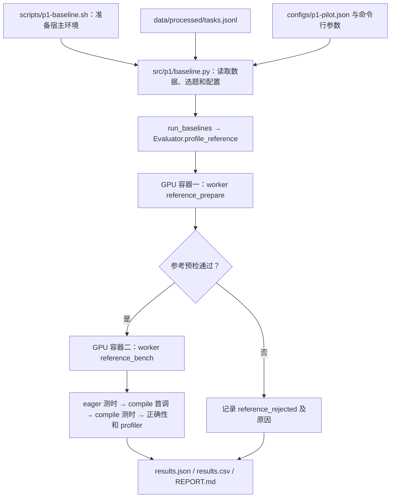

# P1 基线：当前方案与运行说明

更新日期：2026-10-26。服务器项目根目录：`/home/likun/junjxu/CUDA-Agent`。

本文整合当前的数据、模型、工具、评测协议及运行方法。模型正确率、加速比和成本等实际结果，以接下来新建运行目录中的输出为准。

## 1. P1 要测什么

P1 测量原始 Qwen3.5-9B 在 CUDA 代码生成上的起点，尚不更新模型权重。vLLM 负责推理；verl、PPO、RFT 和价值模型训练不参与本阶段执行。评测奖励只作为反馈和记录。

需要区分两个维度：

| 维度 | 方式 | 含义 |
|---|---|---|
| 原始计算程序怎样执行 | eager | 原始 PyTorch 模型直接执行 |
| 原始计算程序怎样执行 | torch.compile | 同一模型经 `torch.compile(mode='default')` 编译后执行 |
| 语言模型怎样生成候选 | single | 一次生成完整源码，不获得执行反馈 |
| 语言模型怎样生成候选 | agent | 使用工具读取文件、分析性能、编译验证并迭代修改 |

单独测量 eager/compile 无需加载 Qwen。运行模型 pilot 时，每个预检通过的任务分别执行 single 和 agent，候选实现都与该任务的 eager/compile 基线比较。

## 2. 数据、划分与 pilot

数据使用作者发布的 CUDA-Agent-Ops-6K，固定 revision 为 `44a734c78c947bfcba5189cbfd13f57a6d29a698`。原始文件为 `data/raw/ops6k.parquet`，SHA256 为 `d4404fc181cad72081f8c1cba720cc1b511fb34dee924079e898bf1e83f6257c`。

每题包含 PyTorch `Model`、构造模型参数的 `get_init_inputs` 和构造输入的 `get_inputs`。这些代码定义参考计算，不是配有专家 CUDA 答案的监督样本。

数据处理去除文档字符串及 AST 位置信息，以规范化源码哈希形成任务组；同组不会跨集合。这不是完整的语义去重。当前按 `data_source` 分层，用 seed=42 的确定性哈希顺序划分 train/test，比例约 8:2；没有 dev/holdout，也不按历史 pilot 题目调整归属。

| 集合 | 原始行数 | 任务组数 |
|---|---:|---:|
| train | 4803 | 4434 |
| test | 1197 | 1108 |
| 合计 | 6000 | 5542 |

比例按任务组计算，重复组大小不同，所以不将原始行强拆成恰好 4800/1200。pilot 仅从 train 中确定性抽取 12 个不重复任务组，保存在 `data/processed/pilot.json`；test 留给配置冻结后的正式评测。

数据文件职责：

| 文件 | 内容 |
|---|---|
| `data/processed/tasks.jsonl` | 全部任务及其 train/test 归属 |
| `data/processed/train.jsonl` | train 中的全部数据行 |
| `data/processed/test.jsonl` | test 中的全部数据行 |
| `data/processed/pilot.json` | 当前从 train 抽取的 12 题 |
| `reports/p1/data-audit.json` | 数据来源指纹、行数/组数、划分计数、接口审计、pilot ID 及相似性审计摘要 |

`data-audit.json` 由 `src/p1/data.py` 的 `prepare()` 调用 `dump()` 自动生成，不是实验结果，也不需要手工维护。执行以下命令会重新生成上述数据及审计，并额外写出 `reports/p1/kernelbench-similarity.json` 的逐题源码相似性记录；只运行 CPU 数据处理。

```bash
cd /home/likun/junjxu/CUDA-Agent
conda activate .runtime/conda/learner
# 处理原始数据，生成划分、train pilot 和审计文件，不启动模型或 GPU。
PYTHONPATH=src python -B -m p1.data
```

确定性排序内部保留固定哈希盐，使清理元数据不会改变现有题目归属。

KernelBench 固定提交为 `423217d9fda91e0c2d67e4a43bf62f96f6d104f1`，L1/L2/L3 共 100/100/50 题。数据处理使用 AST 类型/名称三元组 Jaccard 做源码相似性筛查；目前没有规范化源码精确重复，但这不证明语义无重合或预训练无污染，也不等同于论文的 PythonASTSimilarity 方法。数据处理不会运行 KernelBench GPU 评测。

## 3. 模型与运行环境

主模型为官方 `Qwen/Qwen3.5-9B` 的固定 revision `c202236235762e1c871ad0ccb60c8ee5ba337b9a`，本地目录为 `models/Qwen3.5-9B`。配置没有 `quantization_config`；权重文件头中有 727 个 BF16 张量及 48 个 F32 张量，属于以 BF16 为主的原始浮点 checkpoint，不是 INT4/INT8、AWQ/GPTQ 量化版本。

BF16 描述语言模型权重与推理精度，不会将参考计算任务的输入统一转为 BF16。

| 组件 | 当前用途或来源 |
|---|---|
| `.runtime/conda/learner` | 宿主机上的模型推理与评测控制器 |
| `.runtime/conda/kernel` | 容器内使用的 Python、PyTorch 和 Ninja；只读挂载 |
| `/usr/local/cuda-12.9` | CUDA Toolkit 12.9；只读挂载到容器 |
| 默认 GPU 2 | Qwen 模型生成；generation_gpu 可填整数或编号列表 |
| 默认 GPU 3 | 参考与候选验证、测时；evaluation_gpu 可填整数或编号列表 |
| `third_party/verl` | 后续训练使用的源码；P1 不调用 |

当前目标为 A100 sm_80，PyTorch 为 2.11+cu129；硬件和软件条件不同于论文的 H20 验证池。

### Docker 的作用

沿用服务器已有的自定义镜像 `rpent-vla-env:libero-pro`，固定 image ID 为 `sha256:d58d23b33e24c351dffc6b1bda93dcd7925e3832e2770da6b65e10abfdd05fa0`。它不是 CUDA-Agent 官方专用镜像。

镜像提供 Ubuntu 22.04.5、Bash、常用命令、GCC/G++ 11.4、glibc 2.35 及系统库。项目将自己的 kernel Conda 和 CUDA Toolkit 挂载进去；实际 Python/Ninja 来自 Conda，nvcc 来自挂载的 CUDA 12.9。GPU 驱动由宿主机通过 NVIDIA 容器运行时提供。

开发容器保存一条轨迹内的工作区和 Bash 状态，不提供 GPU、网络或 Docker socket。GPU 评测由宿主控制器向独立容器派发，参考代码、工具和环境只读挂载，可写目录和资源受限。Conda 管理依赖，Docker 提供受限执行边界。

镜像继承的 `CUDA_VERSION=12.6.3`、`VIRTUAL_ENV=/workspace/.venv-vla` 和启动脚本不代表当前调用了旧 Python 或旧 nvcc，但仍可能影响依赖这些设置的工具；系统编译器、动态库搜索路径和 ABI 也会影响兼容性。开发容器覆盖镜像入口，评测容器仍继承入口。固定 image ID 防止标签漂移，但单独复制镜像不足以复现宿主挂载的全部环境。

Docker 客户端为 `/usr/bin/docker`，Docker 管理数据根目录为 `/data2/docker`；当前使用 containerd image store，其 root 为 `/data2/containerd`。这些全局存储位置与项目内 Conda 环境的位置不同。

## 4. 当前模型生成配置

配置来源为 `configs/p1-pilot.json`。下表按配置文件顺序列出当前全部 33 个字段，包含数据准备、模型生成、评测及追溯项；仅用于记录或尚未生效的字段单独注明。

| 字段 | 当前值 | 含义及生效方式 |
|---|---|---|
| `generation_gpu` | `2` | 宿主机 Qwen 生成卡编号或编号列表，例如 [2,3]；每卡独立完整模型副本、按题并行，非张量并行；各进程内部通常显示为 cuda:0。 |
| `evaluation_gpu` | `3` | 参考预检、验证及测时的宿主卡编号或列表，例如 [4,5]；整组评测独占其中一张卡。不能与生成卡重合；Docker 按编号选择。独立 baseline 用 --gpu/--gpus 覆盖。 |
| `context_tokens` | `131072` | Agent 的总上下文窗口，单位 token，同时用于 vLLM 的 max_model_len。提示、累计对话、思考、工具反馈和输出共同占用窗口，不是每轮可新增这么多 token。 |
| `generation_tokens` | `null` | 单次生成的额外输出上限，单位 token。null 表示只受当前窗口余量限制；设置正整数时，与窗口余量取较小值。 |
| `tool_feedback_tokens` | `null` | 加入 Agent 对话的单次工具反馈 token 上限。null 表示不额外按 token 截断；工具自身和错误日志仍可能返回有界摘要，原始反馈另存日志。 |
| `trajectory_seconds` | `null` | 整条轨迹的累计墙钟预算，单位秒。null 表示不设此项上限；设置数值后在每轮开始检查，不能据此保证立即打断正在进行的生成或工具调用。 |
| `compile_seconds` | `300` | 单次候选编译容器的宿主等待超时，单位秒；超时作为编译/执行阶段的问题记录，不是整条轨迹预算。 |
| `evaluation_seconds` | `120` | 非编译评测容器的默认超时，单位秒，用于参考预检、验证及性能测量等；流式比较控制器另保留少量收尾等待余量。 |
| `atol` | `0.01` | 浮点输出比较的绝对误差容差。与 rtol 共同使用，通常要求 abs(候选−参考) ≤ atol + rtol×abs(参考)。参考近常数风险审计也使用该容差。 |
| `rtol` | `0.01` | 浮点输出比较的相对误差容差；0.01 对应相对误差项 1%，不是所有数值统一允许 1% 误差，需与 atol 及输出类型检查共同理解。 |
| `timing_iterations` | `30` | 每一轮稳态性能测量的执行次数；当前每轮 30 次，输入在预热后轮换，分别记录 CUDA event 和同步墙钟耗时。 |
| `timing_rounds` | `3` | 稳态测量轮数；当前共 3 轮。先对各轮内的单次耗时取中位数，再对各轮中位数取中位数。 |
| `baseline_drift_limit` | `0.03` | 候选计时前后基线耗时的最大相对漂移，按 abs(后测/前测−1) 计算。eager 或 compile 任一项超过 0.03（3%）即不接受该次测时，并按评测器规则重试。 |
| `feedback_cases` | `5` | 搜索阶段向模型提供反馈的输入案例数；当前为固定初始化种子下的 5 个输入，不是隐藏验收总数。 |
| `hidden_cases_per_init` | `20` | 隐藏验收中每个初始化种子的基础输入数；20×2 个初始化对应 40 个基础案例，另有重复调用、输入变化和参数重载等附加比较。 |
| `hidden_init_seeds` | `[73001, 73002]` | 隐藏验收的模型参数初始化种子列表；参考预检也会使用这些种子重建参数。它们与语言模型的采样种子是不同用途。 |
| `protocol_version` | `"p1-paper-aligned-v3"` | 写入运行 manifest 的协议标识，用于记录和追溯。此字符串本身不会自动切换评测逻辑，也不表示已经完成论文全部流程的复现。 |
| `single_context_tokens` | `32768` | single 模式的总窗口，单位 token，包含提示、思考和输出；生成余量按此值减去当前提示 token 数计算。 |
| `shell_seconds` | `600` | 持久 Bash 会话中单次命令的超时设置，单位秒；超时会关闭该会话，避免后台命令污染后续调用。不是整条 Agent 轨迹的时长。 |
| `candidate_selection` | `"best_correct_speedup_compile"` | 记录当前固定策略：按相对 compile 的有效加速比降序排列正确候选、源码去重，再逐个隐藏验收并选最快合格项。当前实现不读取此字符串来动态切换策略。 |

`thinking` 在生成代码中固定开启，不是当前 JSON 的可配置字段。single/Agent 的窗口值借用论文披露的设置；temperature/top_p 仍是本地参数，不能视为论文同条件复刻。

128K 配置和 tokenizer 已在 CPU 核对；新版模型流程的 128K GPU 验通及真实性能仍待实际运行确认。

## 5. 从输入到结果的流程

1. **保存题单并预检参考任务。** 新运行读取当前 `pilot.json`，复制为该 run 的 `tasks.json`，记录配置、源码哈希及硬件快照。检查参考任务的可运行性、确定性、有限值和近常数输出风险。预检无效题单独记录，不按模型成败换题；因此 12 题不保证全部进入两种模型模式。
2. **准备工作区。** 放置只读的 `model.py`、上游 `SKILL.md`、固定 `binding.cpp` 和 `binding_registry.h`，候选编写 `model_new.py` 与 `kernels` 下的 CUDA/C++ 源码。模型构造器、参数层级和 `state_dict` 必须兼容参考模型。
3. **模型生成。** single 一次输出 JSON 多文件源码；agent 先分析原始性能，再使用文件和 Shell 工具开发、编译、验证和优化。
4. **源码快照与实现合同。** 每次评测复制候选源码、记录哈希，检查路径、固定文件和实现约束。主要计算要求 raw CUDA，允许 cuBLAS GEMM、cuDNN 卷积；Python 仅承担分配、元数据和扩展调用，不允许 PyTorch 计算回退、`torch.compile`、Triton、精度状态修改或输出缓存投机。
5. **编译与搜索反馈。** 用 nvcc 和 PyTorch 扩展构建工具面向 sm_80 编译。参考与候选在独立容器中重建相同输入和参数，严格加载 `state_dict`。外部控制器比较结构、shape、dtype、有限值及逐元素误差；搜索反馈使用 5 个输入，`atol=rtol=0.01`。
6. **性能与奖励。** 正确候选才进入性能比较。候选计时前后重测基线，漂移超过 3% 时对同一快照重试一次，仍不稳定则不给有效加速比。零值、非有限或非正耗时不产生速度奖励。
7. **选择最终候选。** 搜索候选与最终工作区一起参与选择；按相对 compile 的有效速度降序排列，源码去重后逐个隐藏验收，返回最快合格项。没有合格项则记录失败。
8. **隐藏检查与汇总。** 隐藏验收使用 2 组初始化、每组 20 个输入，并检查重复调用、同地址内容变化、调用顺序及参数重载；隐藏结果不反馈给模型继续优化。记录最终正确性、有效速度、生成 token、累计 prefill token、工具调用和时间成本。

### 工具与持久 Shell

`src/p1/tools.py` 提供 Bash、Read/Write、Edit/MultiEdit、Glob/Grep、TodoWrite，以及 evaluate、profile_reference、submit。文件修改实行先读后写，MultiEdit 全部匹配后才一次写入。

每条 Agent 轨迹保留同一个 CPU 开发容器及 Bash 进程，跨调用保持 cwd、export、函数、工作区和 `/tmp`；轨迹之间不共享会话。Shell 超时会关闭该会话。

兼容层 `src/p1/agent_utils` 只读挂载为开发容器中的 `/workspace/utils`，提供与上游 SKILL 对应的命令：

```bash
# 先分析参考程序的 eager/compile 性能，不要求已有候选。
python3 -m utils.profiling --reference-only
# 编译当前候选；成功时将扩展发布到开发工作区。
bash utils/compile.sh
# 对当前候选执行五例反馈验证。
python3 -m utils.verification
# 候选存在时先验证，再测时和分析性能。
python3 -m utils.profiling
```

这些命令通过受限请求通道让宿主执行固定评测动作；开发容器不能提交任意宿主路径或命令。正式验收会独立重编译源码，不信任工作区已有的 `.so`。

静态检查会跟踪 `forward` 调用的辅助方法，区分 `at::ArrayRef`、Tensor 等类型和真正的计算调用；仅导入 F 不等于执行 F.relu。未知 C++ 符号给出人工审查提示，候选 profiler 另检查运行期 ATen 计算回退。这些机制仍不能证明零误拒或零漏检。

## 6. 精度、计时与结果解释

参考、compile 和候选使用相同 kernel 环境与评测 GPU，matmul/cuDNN 的 TF32 均开启并检查前后状态。TF32 允许使用更快的计算路径，不代表所有 FP32 输入转成 BF16；严格 FP32 审计是另一个实验条件。

性能测量先预热，轮换 5 组输入，每轮 30 次、共 3 轮，记录 CUDA event 和同步墙钟，以中位数汇总。输入克隆不计入执行区间；编译首调和稳态执行分开记录。首调可能命中缓存，不能直接称为冷编译时间。

加速比为“基线耗时 / 候选耗时”，大于 1 表示更快。离散奖励为：失败 -1；正确但未达到速度门槛为 1；比 eager 耗时下降超过 5% 为 2；同时比 eager 和 compile 耗时下降超过 5% 为 3。5% 时间下降对应候选耗时小于基线的 0.95 倍。

没有正确且测时有效的候选时，不报告有效候选加速比，几何平均加速比为 `null`，不是 0 倍。基础设施故障、参考任务无效、输出格式/实现合同问题和候选数值错误需要分开解释。累计 prefill 会重复处理对话历史，不等于相同数量的不重复文本；轨迹墙钟也不等于纯 GPU 计算时间。

## 7. 亲自运行

### 7.1 仅测 eager/torch.compile

```bash
cd /home/likun/junjxu/CUDA-Agent
# 列出 train 中排序后的前 12 个任务，不启动 GPU。
bash scripts/p1-baseline.sh --list --split train --limit 12
# 预览测量任务和 GPU 编号，不启动 GPU。
bash scripts/p1-baseline.sh --dry-run --split train --limit 1 --gpu 3
# 实际测量 train 中排序后的第一题，使用 GPU 3；不加载 Qwen。
bash scripts/p1-baseline.sh --split train --limit 1 --gpu 3
```

baseline 入口默认创建带时间戳的独立目录。这里的 `--limit 12` 是排序后的前 12 个 train 任务，不等同于模型 pilot 的 12 题；需要指定题目时使用 `--task-id`。

### 7.2 运行 Qwen single/agent pilot

启动脚本会加载 Conda 并激活 learner，无需额外 activate.sh。先确认配置指定的所有卡可用（默认生成 2、评测 3）；控制器会逐卡检查显存占用，超过 100 MiB 时拒绝启动，并要求项目所在文件系统至少有 80 GiB 可用空间。

```bash
cd /home/likun/junjxu/CUDA-Agent
# 启动当前 train pilot，GPU 2 生成、GPU 3 评测；该命令会执行真实实验。
bash scripts/p1-run.sh --run runs/p1/pilot-train-v3-seed42
```

首次运行使用新的输出目录。已有 manifest 的目录需要显式 `--resume`，且保存配置必须与当前配置完全一致；恢复时使用该 run 自己保存的题单。运行过程中不要修改其配置、源码或题单。

```bash
conda activate /.runtime/conda/learner
# 明确指定本次新 run，避免状态工具采用历史默认路径。
PYTHONPATH=src python -B -m p1.status --run runs/p1/pilot-train-v3-seed42
```

上述示例仅说明操作方式；本次文档整理未替用户执行 GPU 命令，也不自动启动定时跟进、完整 test、KernelBench 或 P2 训练。

## 8. 输出文件与检查方法

| 位置 | 内容 |
|---|---|
| 模型 run 的 `tasks.json` | 本次实际使用的固定题单 |
| 模型 run 的 `manifest.json` | 配置、任务 ID、源码哈希、硬件快照和运行状态 |
| 模型 run 的 `references/` | 参考任务预检、基线与相关日志 |
| 模型 run 的 `trajectories/` | single/agent 生成文本、工具反馈、工作区、逐轨迹结果和成本 |
| 模型 run 的 `evaluations/` | 候选快照、编译日志、逐例检查、性能与隐藏验收 |
| 模型 run 的 `results.json` | 持续更新的完成结果及已记录的无效任务 |
| 模型 run 的 `summary.json` | 整个 pilot 正常结束后的分模式汇总 |
| baseline run 的 `results.json`、`results.csv`、`REPORT.md` | eager/compile 时间、加速比、首调时间和汇总说明 |

查看结果时先检查参考任务有效性，再检查候选正确性、测时有效性及速度，最后分析成本和失败类别。任务被预检隔离、轨迹中断或整个流程未正常结束时，要明确相应分母及缺失结果；不能仅凭 `summary.json` 是否存在判断已完成轨迹是否保存。

## 9. 与原论文的对应及边界

依据：[论文 CUDA Agent](https://arxiv.org/abs/2602.24286)及[公开仓库](https://github.com/BytedTsinghua-SIA/CUDA-Agent)，项目引用的上游快照为 `473025c8af7878e928525138b5cb327d6bcdf9dd`。

| 项目 | 论文披露 | 当前 P1 |
|---|---|---|
| 基座模型 | Seed1.6，230B 总参数/23B 激活参数 | 用户指定 Qwen3.5-9B，架构和规模不同 |
| 单轮窗口 | 单轮 RL 为 32768 | single 使用该窗口数字，不声称论文披露了相同的单轮推理输出上限 |
| Agent 窗口 / turn 上限 | 131072 / 200 | 配置相同，128K GPU 运行仍待确认 |
| 单次 4096 token、整条 30 分钟 | 未找到足以复刻的明确依据 | 不设置这两个额外默认上限；保留单次操作超时 |
| temperature/top_p | 未找到足以完全复刻的数值 | 本地使用 0.7/0.95 |
| 开发工具 | 持久 Bash、文件工具、SKILL 等 | 提供对应 CUDA 任务工具和 utils 兼容命令；不等同于完整 OpenHands 系统 |
| 原始性能分析 | 先分析参考程序瓶颈 | profile_reference 与 --reference-only 支持 |
| 候选选择 | 轨迹中对 compile 最快的正确解 | 按速度排序、去重并隐藏验收后选择 |
| 正确性 | 搜索阶段五例反馈 | 五例反馈，另加本地隐藏检查及状态审计 |
| 奖励 | -1/1/2/3 及 5% 时间下降门槛 | 采用对应里程碑；不更新权重 |
| 性能统计 | 重复测量、平均等论文条件 | 本地采用三轮中位数及 3% 漂移门槛 |
| 数据与硬件 | 论文训练流程、KernelBench 250 题、H20 验证池 | train pilot、A100、torch2.11+cu129 |
| 训练 | 单轮 PPO、RFT/价值预训练、Agentic PPO | P1 不训练 |

论文的单轮训练阶段及 w/o Agent Loop 消融，不等同于未训练 Qwen 的 single/agent 本地对照。当前 P1 不能直接检验论文完整 RL 流程的效果，也不能将小 pilot 的结果视为 KernelBench 主表复现。

## 10. 验证与代码职责

当前实现已完成 CPU 协议回归和无 GPU 容器接口检查；这些验证不替代新版真实模型、隐藏验收与性能路径的 GPU 集成验证。后续以实际运行证据更新结论。

```bash
conda .runtime/conda/learner
# 在项目根目录运行 CPU 回归，不加载模型或使用 GPU。
PYTHONPATH=src python -B -m unittest discover -s tests/p1 -v
# 检查持久容器和 utils 请求通道；使用 CPU Docker 与假评测回复。
PYTHONPATH=src python -B tests/p1/sandbox_smoke.py
```

`src` 保存可复用实现，`scripts` 保存环境和启动入口，`tests` 保存回归与集成测试，`runs` 保存每次实验的原始证据，`reports` 保存当前说明和数据审计。自有脚本、函数和关键流程有中文注释；`scripts` 下每条命令的用途写在其紧邻上一行。`gpu_*.py` 是需显式运行的 GPU 测试，不会因导入测试模块而自动启动实验。


## 11. p1-baseline 的数据、配置、代码与运行全过程

本节沿当前代码逐步说明 `p1-baseline` 的真实执行路径。下面的命令是运行示例，撰写本节时没有执行 GPU 实验。

### 11.1 先明确：这次究竟测什么

`p1-baseline` 回答的是：**对于同一段 PyTorch 计算，直接执行 eager，与使用 torch.compile 后执行，各需要多长时间？**

这里每个任务的 `Model` 是一个计算程序，例如矩阵乘法、卷积或一串算子的组合，不是 Qwen 语言模型。两种方式执行同一任务，使用同一组模型参数和输入；编译后还要检查输出是否与 eager 一致。

这条入口不加载 Qwen，不使用 vLLM 或 verl，不让 Agent 写源码，不运行自定义候选 CUDA 的编译和隐藏验收。它建立的是后续候选优化要比较的两个参考起点。

整体调用关系如下：



两个容器按顺序使用同一张评测 GPU，不是同时占两张卡。每题走完后才处理下一题。

### 11.2 哪些数据和文件会被读取

| 文件或目录 | 本入口的用途 |
|---|---|
| `scripts/p1-baseline.sh` | 启动入口，激活 learner、设置路径并把参数交给 Python |
| `scripts/set-env.sh` | 提供 CUDA、线程、缓存和临时目录的公共环境设置 |
| `src/p1/baseline.py` | 解析参数、读取任务、选题、检查 GPU、调度逐题测量并汇总 |
| `src/p1/data.py` | 被导入以取得项目根目录 `ROOT` 和 JSON 写入函数 `dump`；本次不会自动执行其中的数据生成程序 |
| `data/processed/tasks.jsonl` | 实际读取的任务全集，包含源码和 train/test 归属 |
| `configs/p1-pilot.json` | 读取公共配置，选中的 GPU 等运行设置会传给容器 |
| `src/p1/evaluation.py` | 准备参考任务、创建容器、传递配置和文件、收集结果 |
| `src/p1/worker.py` | 在容器内实际执行参考预检、torch.compile、GPU 测时和 profiler |
| `.runtime/conda/learner` | 宿主控制器使用的 Python 环境 |
| `.runtime/conda/kernel` | 容器内实际运行 PyTorch 的 Python 环境，只读挂载 |
| `/usr/local/cuda-12.9` | 容器使用的 CUDA Toolkit，只读挂载 |
| 配置指定的 Docker 镜像 | 提供容器的 Linux 用户空间和系统工具 |

`data/processed/tasks.jsonl` 的每行是一条 JSON 记录，主要字段如下：

| 字段 | 用途 |
|---|---|
| `code` | 真正执行的 Python 源码，包含 Model/get_init_inputs/get_inputs |
| `task_id` | 规范化源码组对应的任务标识，用于去重、选题及输出目录命名 |
| `split` | train 或 test；供 `--split` 筛选 |
| `ops` | 算子名称标签，用于列题展示；具体计算以 code 为准 |
| `data_source`、`row_index` | 记录数据来源及原始行号 |
| `source_hash`、`normalized_hash` | 辅助追溯源码和分组 |

这些记录此前由 `src/p1/data.py::prepare()` 从 `data/raw/ops6k.parquet` 生成。**实际跑 baseline 时，不会重新读取 Parquet、重新划分数据或重新抽 pilot。**

本入口也不读取 `train.jsonl`、`test.jsonl`、`pilot.json`、`reports/p1/data-audit.json`，而是从 `tasks.jsonl` 的 split 字段中筛选。刚补齐的 `upstream/CUDA-Agent/agent_workdir` 官方示例及其 utils、binding、kernels，也不参与这条入口；当前调用的是本项目自己的控制器和 worker。

### 11.3 启动脚本先做什么，为什么需要两个 Conda 环境

例如执行：

```bash
# 在服务器项目根目录启动一题真实基线测量，使用 GPU 3。
bash /home/likun/junjxu/CUDA-Agent/scripts/p1-baseline.sh --split train --limit 1 --gpu 3
```

启动脚本依次做以下事情：

1. 开启 Bash 严格模式并切换到固定项目根目录，使命令失败及时退出、相对路径保持一致。
2. 加载 `/data2/likun/miniconda/etc/profile.d/conda.sh`，激活项目 `.runtime/conda/learner`。
3. source 公共 `set-env.sh`，设置 CUDA_HOME、PATH、缓存目录和线程等环境变量。这里只设置变量，不会初始化 CUDA 或开始计算。
4. 把宿主 `CUDA_VISIBLE_DEVICES` 覆盖为空。公共脚本中的 P0 默认 GPU 4 不会用于本次计算；真正的 GPU 由后面 Docker 的 `--gpus device=3` 指定。
5. 将项目 src 加入 PYTHONPATH，执行 `python -B -m p1.baseline "$@"`。`-B` 禁止写入 pyc，`"$@"` 保留原始命令行参数。

learner 在宿主负责文件和容器调度；kernel 在容器中负责实际 PyTorch/GPU 运算。宿主会导入一些 PyTorch 辅助代码，但其 GPU 可见性为空，不进行本次 GPU 计算。Docker 管执行边界，Conda 管 Python 依赖，它们承担不同职责。

公共脚本还包含 Hugging Face、vLLM 等变量，但这些变量的存在不会使 baseline 自动加载语言模型。容器另行设置自己的 PATH、缓存和临时目录，部分值会覆盖宿主设置。

### 11.4 如何选题：--limit 与 pilot_tasks 不是一回事

`baseline.main()` 读取 `tasks.jsonl` 后，调用 `select_tasks()`：

1. 按 `--split` 过滤，默认 train。
2. 用 task_id 去重，因此同一源码组不会因为包含多条原始行而重复测量。
3. 按 task_id 的字典顺序排序。
4. 未指定 ID 时取前 `--limit` 个，默认只取 1 个；显式指定 `--task-id` 时，返回指定的全部 ID，`--limit` 不再截断它们。
5. 如果某个指定 ID 不属于所选 split，直接报错，避免悄悄换题。

因此，`--limit 12` 表示“排序后的前 12 个 train 任务”，不是配置中的 12 道模型 pilot，也不是随机抽样。配置中的 `pilot_tasks` 和 `pilot_split` 在这里不参与选题。

当前排序第一题为 `ops6k-00192d5b7124134b`，参考计算是：

```python
# 对每个矩阵保留上三角部分。
x = torch.triu(x, diagonal=0)
# 沿 dim=1 做 logsumexp，得到参考输出。
return torch.logsumexp(x, dim=1, keepdim=False)
```

该题的输入形状由 get_inputs 定义，为 `[512, 1024, 128]`，输出为 `[512, 128]`。输入的形状、dtype 和计算内容来自题目源码，不会因为语言模型使用 BF16 而统一改成 BF16。

三个运行分支要分清：

| 参数 | 做到哪一步 | 是否使用 GPU/创建实验输出目录 |
|---|---|---|
| `--list` | 选题并打印 ID/ops，随后返回，甚至不读取公共配置 JSON | 否 |
| `--dry-run` | 选题、读配置、应用 --gpu 覆盖并打印选中 ID/评测 GPU | 否；也不会核验 GPU 当前是否空闲 |
| 不带上述参数 | 检查指定卡后创建目录并执行；新运行不传卡号时默认 GPU 7 | 是 |

### 11.5 配置实际如何生效

真实运行中，`--gpu 3` 会把读入内存的 `evaluation_gpu` 改为 3，不会修改磁盘上的 `p1-pilot.json`。多卡可使用 `--gpus 2,3`，各评测器独立持有实际卡号，共用同一份只读 `worker-config.json`。调用 nvidia-smi 检查指定卡的显存使用，沿用当前代码中用户设置的 60000 MiB 阈值；不会结束已有进程。该阈值不能证明 GPU 空闲，正式测时仍应选择无其他任务干扰的卡。新增文件锁只协调同项目新版基线控制器，无法阻止其他程序使用 GPU。

| 配置或代码设置 | 在 baseline 中的实际作用 |
|---|---|
| `evaluation_gpu` | 单卡用 --gpu 选择；多卡用 --gpus 列表分配；新运行不传时保留入口默认 GPU 7 |
| `docker_image` | 选择已存在的固定镜像；--pull=never 不自动拉取 |
| `atol=0.01`、`rtol=0.01` | 近常数筛查及 compiled/eager 输出比较的容差 |
| `feedback_cases=5` | 基线测时轮换的输入数，也是 compiled/eager 比较的案例数 |
| `hidden_init_seeds=[73001,73002]` | 本入口仅在参考预检中额外构造这两组参数，并保存参数快照 |
| `hidden_cases_per_init=20` | 预检会记录其对应的隐藏案例计数，但本入口不执行这些隐藏候选比较 |
| `timing_iterations=30` | 每轮稳态测量的执行次数 |
| `timing_rounds=3` | 稳态测量轮数，采用两级中位数汇总 |
| `evaluation_seconds=120` | 是容器公共默认超时；本 baseline 路径显式传入 300 秒，覆盖该默认值 |
| `compile_seconds=300` | 用于候选扩展编译；此处不是控制 torch.compile 首调的字段 |
| `baseline_drift_limit=0.03` | 用于候选前后基线漂移审核；独立 baseline 不执行这一套前后复测 |
| `seed=42` | 影响此前的数据处理；参考预检和测时输入使用 worker 内固定的种子，不能靠改这个值切换本次所有测试输入 |
| model/revision、生成 GPU、上下文、采样、turn/Shell、候选选择等字段 | 随整个配置保存到 manifest，但不会在此入口触发对应的模型或 Agent 功能 |

当前参考预检与参考测量各有一个**代码中显式写定的 300 秒容器超时**，不是两个阶段合计 300 秒。只修改 `evaluation_seconds` 或 `compile_seconds` 不会改变这两个显式参数。

### 11.6 新建输出目录并准备参考任务

GPU 检查通过后，`run_baselines()` 新建输出目录。默认形如 `runs/p1/baseline-<时间戳>`，显式使用北京时间 UTC+8；也可用 `--run` 指定目录。目录已存在时拒绝覆盖，需要通过 `--resume --run <目录>` 显式恢复。续跑从原 manifest 读题单和配置，不重新按当前 --limit 选题，详见第 12 节。

控制器先写出：

- `worker-config.json`：各卡共享的只读 worker 配置，由主控制器在线程启动前写一次，单卡/多卡均保持原文件名。实际卡号由宿主的 `Evaluator.gpu` 单独传给 Docker。
- `manifest.json`：记录 mode=reference_only、完整配置、所选 task_ids，以及 loads_qwen=false。

然后逐题调用 `Evaluator.profile_reference(task)`。新目录没有该题的参考快照，因此进入 `Evaluator.prepare(task)`：

1. 将 tasks.jsonl 中的 code 写为该 run 的 `references/<task_id>/model.py`。这不是上游示例 model.py，而是本次选定任务的原始代码。
2. 启动 `reference_prepare` 容器，检查参考计算并保存初始化参数。
3. 如果预检合格，再启动 `reference_bench` 容器进行 eager/compile 测量。

新 baseline 每题通常只调用一次这条路径；预检通过后使用初始测量结果，不会无故重复完整测量。共享函数 profile_reference 虽支持后续复用参数并重新测时，但 CLI 本次不会主动循环重复调用同一题。

### 11.7 Docker 具体带进去什么

容器通过 kernel 环境 Python 执行 `/worker.py reference_prepare` 或 `/worker.py reference_bench`，并使用 `-I -B`：隔离 Python 的用户环境路径并禁止写入 pyc。

| 宿主内容 | 容器中的位置/权限 | 用途 |
|---|---|---|
| `.runtime/conda/kernel` | 同一绝对路径，只读 | 实际 Python、PyTorch、Ninja 等依赖 |
| `/usr/local/cuda-12.9` | 同一路径，只读 | CUDA Toolkit |
| `src/p1/worker.py` | `/worker.py`，只读 | 当前项目的执行代码 |
| run 的 worker-config.json | `/config.json`，只读 | 各卡共用的评测参数；实际设备由 Docker --gpus 单独指定 |
| 该题 references 目录 | `/reference`，只读 | 参考源码和已有文件 |
| 该阶段的输出目录 | `/outputs`，可写 | 结果、日志、参数快照 |
| cases/input-spec（测量阶段） | `/inputs`，只读 | 重建模型和输入所需的源码及参数 |
| 该题 compile-cache（测量阶段） | `/refcache`，可写 | TorchInductor/Triton 编译缓存 |

容器没有网络，根文件系统只读，临时目录使用 tmpfs，CPU 配额为 4、系统内存限制为 24 GiB。这里的 24 GiB 不是 GPU 显存上限。只向容器提供指定编号的 GPU；容器内看到的 cuda:0 可以对应宿主的 GPU 3。worker 另记录 GPU UUID 用于溯源，选择设备仍按编号。

镜像提供系统工具和库，实际 torch 来自挂载的 kernel Conda。测量结束后容器被删除，挂载到宿主 run 中的结果和编译缓存保留。

### 11.8 第一个 GPU 容器：参考预检和参数保存

`worker.main()` 先统一环境：matmul/cuDNN TF32 均开启、cuDNN benchmark 关闭、PyTorch CPU 线程数设为 4。随后 `worker.prepare(cfg)`：

1. 加载 `/reference/model.py`，从中取得 Model、get_init_inputs、get_inputs。
2. 分别使用初始化种子 71001、73001、73002，同步 Python、NumPy、PyTorch 和 CUDA 随机源。
3. 每个种子下构造 `Model(*get_init_inputs()).eval().cuda()`，保存初始化参数和 state_dict。无可训练参数的任务可以有空 state_dict，这不代表任务不合法。
4. 对输入种子 72000、72001 分别生成输入，把同一输入复制后执行两次参考程序，检查重复结果一致及浮点输出有限值。
5. 采样输出元素并记录 shape/dtype/numel 等统计，检查不同输入及初始化下是否都近似同一个常数。

为什么这样做：先确认参考程序本身可以作为可靠测量对象；固定并保存参数，避免下一容器重新初始化出不同权重；排除本项目认为不适合后续优化评测的近常数任务。

确定性检查在各自初始化内进行，不要求不同初始化的输出彼此相等。近常数判断是采样筛查，不是穷尽证明；筛查拒绝也不等于原程序数学上错误。

输出的 input-spec 包含参考源码和 `state-71001.pt`、`state-73001.pt`、`state-73002.pt`。后续测时使用 71001 这一组参数；另外两组用于本次预检及共享评测流程的准备，不会自动执行候选隐藏验收。

如果容器报错、超时或被判近常数，控制器保存原因并把该题记为 reference_rejected，跳过性能结果。这个状态可能来自预检，也可能来自后续初始基线测量失败，不能仅凭状态名断言数据源码有错。

### 11.9 第二个 GPU 容器：eager 与 compile 测量

此时进入 `worker.bench(cfg, candidate=False)`，过程如下：

**第一步，重建相同模型与输入。** 从 input-spec 加载 Model，使用保存的初始化参数构造实例，再严格加载 state_dict。按输入种子 72000 至 72004 生成 5 组输入，输入由 get_inputs 决定。所有 forward 均在 eval 和 no_grad 下执行，不计算训练梯度。

**第二步，测 eager。** 直接调用 Model。先用 5 组输入各预热一次并同步，再做 3 轮、每轮 30 次测量；每次轮换输入并先克隆、同步，随后开始计时。

每次测量同时记录两种时间：

| 时间 | 计时范围与用途 |
|---|---|
| CUDA event ms | GPU stream 上记录的事件间隔，用于比较设备执行耗时；不等于 profiler 中所有 kernel 时间的简单求和 |
| 同步墙钟 ms | CPU 开始调用至 GPU 同步完成的时间，包含 Python/调度及同步等开销 |

输入克隆发生在这两个计时区间之前。两种时间都先对每轮 30 次取中位数，再对 3 个轮中位数取中位数。每种模式共记录 90 次正式执行，预热、首调、正确性比较及 profiler 的执行另计。

**第三步，创建编译版本并记录首调。** 调用 `torch.compile(model, mode='default')`，执行第一组输入并等待 GPU 完成，记录 compile_first_call_seconds。这里可能包含首次编译、加载和第一次执行，因此单独保存，不混入之后的稳态时间；也不能保证是完全无缓存的冷编译。

**第四步，测 compile 稳态。** 对 compiled 执行与 eager 相同的五组输入预热、30×3 次测量和中位数汇总。编译优化由 PyTorch 完成，可能生成或调用 CUDA/Triton 等内核；这不是 Agent 生成的候选。候选禁止 Triton 的实现合同不会施加到 torch.compile 参考基线上。

**第五步，核对编译前后输出。** 对 5 组输入比较 compiled 与 eager 输出，使用 atol=rtol=0.01。通过后记录 compile_correct=true；比较失败则 worker 返回 error，该题不以成功性能结果汇总。当前代码是在稳态测量之后做此比较，但最终成功记录必须通过它。

**第六步，另做性能分析。** 分别对 eager、compile 的第一组输入运行一次 profiler，记录调用名、调用次数和 device_us 等统计。profiler 在正式计时之后独立运行，其耗时不混入稳态结果。名称和占比有助于解释是否存在融合、调度或大算子瓶颈，但一次采样不足以证明完整性能原因。

**第七步，记录 TF32 状态并返回。** worker 保存 TF32 前后状态、state_mutations、两种耗时、编译首调时间和 profiles。compile 可能包含图中断或回退，当前代码未强制 fullgraph；compile 成功不等于所有算子被融合为一个 kernel。

### 11.10 结果如何落盘，先看哪些文件

一次成功的单题运行，主要目录结构如下。下面以项目下 `runs/p1/baseline-<时间>/` 为根：

```text
baseline-<时间>/
├── manifest.json                 # 本次模式、配置、task_count、题单；明确不加载 Qwen
├── worker-config.json            # 各卡共用的只读配置，单卡/多卡均保留此名称
├── results.json                  # 首条记录为 MEAN，后续为各题摘要及 detail_path
├── results.csv                   # 保留表头，首个数据行为 MEAN，逐题更新
├── REPORT.md                     # 表格首个数据行为 MEAN，含拒绝原因，逐题更新
└── references/<task_id>/
    ├── model.py                  # 从本次 JSON 任务记录导出的参考源码
    ├── preflight.json            # 仅保存状态及阶段结果路径
    ├── cases/
    │   ├── worker.log            # 第一个容器的标准输出和错误
    │   ├── prepare_result.json   # 完整预检结果，含 controller_seconds
    │   └── input-spec/
    │       ├── model.py          # 用于后续模型和输入重建的源码
    │       └── state-*.pt        # 各初始化种子的参数快照
    ├── initial-bench/
    │   ├── worker.log            # 第二个容器的标准输出和错误
    │   └── bench_result.json     # 完整测时结果，含 controller_seconds
    └── compile-cache/
        ├── inductor/            # TorchInductor 缓存（按实际生成）
        └── triton/              # Triton 缓存（按实际生成）
```

`preflight.json` 的结构示例：

```json
{
  "status": "ok",
  "prepare_result_path": "references/<task_id>/cases/prepare_result.json",
  "bench_result_path": "references/<task_id>/initial-bench/bench_result.json"
}
```

上述路径以及根目录 `results.json` 的 `detail_path` 都相对于本次 run 根目录。
参考预检未通过时不会生成测时结果，也不会写入 `bench_result_path`；拒绝原因在预检详情文件中。若初始测时本身失败，仍保留 `bench_result_path` 指向失败记录。
根目录不再嵌套完整 `detail`；成功题的详情路径指向 `bench_result.json`，拒绝题指向 `preflight.json`。
Agent run 的根目录 `results.json` 同样只保留各题/模式的标量摘要和轨迹详情路径；完整轨迹结果仍在 `trajectories/<task_id>/<mode>/result.json`。
各次额外参考测时（profile、前后基线）的阶段文件也统一使用 `bench_result.json`。
这些约定只用于后续运行，本次不迁移或删除已有 runs 结果。

JSON 中关键性能字段：

| 字段 | 怎么理解 |
|---|---|
| `status` | 先判断是否 ok；否则沿 detail_path 阅读详情和逐阶段日志 |
| `eager_cuda_ms` / `compile_cuda_ms` | 两种执行方式的稳态 CUDA event 耗时，毫秒 |
| `eager_wall_ms` / `compile_wall_ms` | 两种执行方式的同步墙钟耗时，毫秒 |
| `compile_over_eager_speedup` | eager_cuda_ms ÷ compile_cuda_ms；大于 1 表示 compile 更快 |
| `compile_first_call_seconds`（详情文件） | 编译包装及首调耗时，秒，注意与 ms 的单位区别 |
| `compile_correct`（详情文件） | 编译前后输出比较是否通过 |
| `profiles`（详情文件） | eager/compile 的算子或事件统计，device_us 使用微秒 |
| `tf32_before/after`、`state_mutations`（详情文件） | 精度状态记录 |
| `controller_seconds`（详情文件） | 该测量容器从启动至收尾的控制器墙钟时间，不是单次 kernel 时间 |

例如 eager=2 ms、compile=1 ms，则加速比为 2；这是解释字段的假设数字，不是实测结果。若 compile=3 ms，加速比约 0.67，表示该配置下 compiled 更慢，不代表计时必然有错。

worker 以 JSON 返回的错误通常会被汇总后继续处理后面的任务；宿主发生未捕获异常仍可能终止整个程序。运行中优先看终端逐题结果与 results.json，CSV/REPORT 与 JSON 每完成一题共同更新；尚未完成首题时，MEAN 记录的已处理数为 0。阶段日志仍可独立查看。

baseline 不生成模型 pilot 的 summary.json，也没有 Agent 轨迹；不要用模型 pilot 的状态汇总口径解读它。

### 11.11 你可以按什么顺序亲自运行

```bash
# 切换到项目根目录。
cd /home/likun/junjxu/CUDA-Agent
# 只确认将要运行的第一道 train 任务，不使用 GPU。
bash scripts/p1-baseline.sh --list --split train --limit 1
# 只预览题目及 GPU 选择，不检查 GPU 占用、不创建运行目录。
bash scripts/p1-baseline.sh --dry-run --split train --limit 1 --gpu 3
# 实际跑这一题；先不指定 --run，让程序创建新的默认时间戳目录。
bash scripts/p1-baseline.sh --split train --limit 1 --gpu 3
```

确认单题结果、编译正确性和日志符合预期后，可自己选择扩展数量。以下两种选题方式是独立示例，按需要选择执行：

```bash
# 实际测量按 ID 排序后的前 12 道 train 任务，生成新的默认运行目录。
bash scripts/p1-baseline.sh --split train --limit 12 --gpu 3
# 或显式选择某道 train 题，使用一个尚不存在的自定义目录。
bash scripts/p1-baseline.sh --task-id ops6k-00192d5b7124134b --gpu 3 --run runs/p1/baseline-manual-one
```

`--task-id` 可以重复传入以指定多题。当前只核查了流程和代码，没有代你执行以上真实测量命令。

### 11.12 这条入口的结论边界

- 独立 baseline 没有执行候选路径的前后基线漂移审核、隐藏验收和速度奖励；baseline_drift_limit 不会在这里自动剔除漂移结果。
- 当前 baseline 汇总主要按 worker 的 status 取数，记录的 TF32 状态变化也没有在该入口额外统一转为失败；完整的非正/非有限时间和状态审核主要位于候选评测路径。因此解读结果时仍应检查详细时间、compile_correct 和精度状态，不能仅见 status=ok 就视为覆盖所有测量有效性条件。
- 预检、时钟、编译缓存及 PyTorch 版本都会影响测量；本次只测选定任务和当前机器，不代表全部 train/test 的平均水平。
- 这次结果可以告诉你原始 PyTorch 和自动编译优化的性能起点，不能据此评估 Qwen 的 CUDA 编程能力或论文 RL 的提升。

### 11.13 均值与样本数量

`manifest.json` 在 `task_ids` 前写入 `task_count`，表示本次选中的去重任务数，包含后续被拒绝的题。
`results.json` 首条记录为 `task_id="MEAN"`；CSV 和 Markdown 保留表头，首个数据行为均值。
均值行的 `sample_count`、`valid_sample_count`、`rejected_sample_count` 分别表示已处理、成功、未通过的样本数，不将 MEAN 本身算作样本。
每个数值指标只对成功样本中实际存在的有限数值计算算术均值，缺失、NaN、Inf 和拒绝样本不补零；无有效数据时 JSON 使用 null，CSV 留空，Markdown 使用 —。
各题加速比的算术均值不等于 eager 平均耗时除以 compile 平均耗时；此处按逐题加速比求均值。
除原有五项耗时/加速指标外，摘要补充 `compile_first_call_seconds` 和 `controller_seconds`，与稳态毫秒耗时区分。
拒绝样本保留 `detail_path`，并增加 `rejection_stage`、`rejection_reason`；REPORT 的拒绝表可追踪各阶段证据。
`reference_rejected` 是当前控制器的统一状态，既可能是近常数或非有限输出，也可能是环境显存不足、输入/参数设备混用、安全反序列化或比较器异常，不能都理解为题目本身无效。

## 12. 纯基线的断点续跑与多卡执行

本节对应 `src/p1/baseline.py`、`src/p1/helper/baseline_state.py` 的调度与持久化扩展，不修改参考输入、容差、编译方式或测时轮数，不启动 Qwen/Agent。未自动停止、恢复或重跑已有实验，也未修改旧运行的中间结果。

### 12.1 怎么运行

```bash
cd /home/likun/junjxu/CUDA-Agent
# 新建多卡运行；示例卡号需要先确认空闲，每张卡独立处理一题。
bash scripts/p1-baseline.sh --split train --limit 100 --gpus 2,3 --run runs/p1/baseline-multi
# 只读预览：查看固定题单、可复用数量和待处理数量，不启动或查询 GPU。
bash scripts/p1-baseline.sh --resume --run runs/p1/baseline-multi --gpus 2,3 --dry-run
# 继续原目录剩余题目；也可只指定 --gpu 7 进行单卡续跑。
bash scripts/p1-baseline.sh --resume --run runs/p1/baseline-multi --gpus 2,3
```

`--gpu` 和 `--gpus` 互斥；仅接受非负数字编号，不能重复。新运行不指定时保留 GPU 7 默认值。恢复不指定时使用原 manifest 的 `evaluation_gpu`，并不自动沿用此前多卡列表；建议恢复时明确传卡号。`--resume` 必须配合 `--run`，不能再传 `--split/--limit/--task-id`，防止把另一批题混进旧目录。

对于 `runs/p1/baseline-20261025T223047` 这类由旧代码启动的运行，必须先让旧进程结束或自行停止，再使用同一目录的 `--resume`；当前仍在运行的旧进程不会动态获得新能力。只读预览可以在原运行期间执行。

### 12.2 怎么判断“已完成”，为什么不会重测

续跑先验证原 manifest：纯基线模式、原题单及顺序、原配置；卡号可换，其余配置保持不变。新运行额外保存各题源码/split 指纹及 worker、评测器、合同检查代码的指纹，发生变化时拒绝混合结果。旧 manifest 没有历史指纹，只能核对现存 `model.py` 与当前任务源码；首次恢复才补存当前指纹，不能反向证明旧运行完整的历史环境和代码身份。

随后读取每题的正式阶段文件和预检索引，而非仅凭根 `results.json` 或 `input-spec` 目录存在判断：

| 文件 | 恢复时检查什么 |
|---|---|
| `references/<id>/preflight.json` | 状态是否为终态，阶段路径是否确实属于本题标准路径 |
| `cases/prepare_result.json` | 完整 JSON、预检状态、近常数标记、控制器补写的 controller_seconds |
| `initial-bench/bench_result.json` | 需要测时时是否存在完整终态记录、控制器收尾和原有数值字段 |
| 根 `results.json/CSV/REPORT.md` | 根据正式阶段详情重建；汇总丢失或截断不导致完整题重新运行 |

成功、预检拒绝和已记录的测时失败/超时均算已完成，默认都跳过。恢复不会暗中重试拒绝题；若想另测此类题，显式新建 run。只有未完成或文件损坏的题才会重做：先将该题整个参考目录移至 `interrupted/<北京时间-随机后缀>/<id>/`，保留日志和编译缓存证据，然后从原始预检重新执行，避免残缺参数快照被误复用。归档中的中断成本不计入最终成功样本的性能均值。

### 12.3 多卡具体并行什么

主控制器维护同一份固定题单，每张指定卡最多执行一题；一题内仍按“参考预检 → eager/compile 测量”顺序执行，两种模式的性能来自同一张卡。某卡先结束就领取下一题，因此是动态分配，避免难题让静态分片一直拖尾。每个题目的源码、参数、日志与编译缓存目录独立；各卡共用同一份 `worker-config.json`，由主控制器在线程启动前写一次，各评测器只读挂载，不按卡号反复覆写。

实际卡号保存在各宿主评测器的 `gpu` 属性中，由 Docker `--gpus device=编号` 选择。worker 不读取 `evaluation_gpu` 来选卡；公共 JSON 里的该字段保留原单卡默认值，实际多卡列表以 `manifest.execution.gpus` 为准，每条结果中的 `evaluation_gpu` 记录真正执行卡号。多卡续跑不会将原 `worker-config.json` 改名，也不生成按卡拆分的配置文件。

汇总只由主控制线程写入，按原题单顺序排列，与任务完成先后无关；JSON 首行及 CSV/Markdown 首数据行仍为 MEAN。逐题摘要和阶段详情记录 `evaluation_gpu`，便于核对来源；旧阶段缺少此字段时按旧单卡 manifest 的卡号补记。每次完成一题后更新三种汇总及 manifest 的执行进度，不生成额外的逐题 checkpoint JSON 副本。

这不是单个算子分布式计算，也不是 torch DataParallel。增加卡数会同时增加 CPU、宿主内存和编译压力；每个活动容器原有的 4 CPU/24 GiB 宿主内存限制仍保留，不能承诺线性加速。跨卡测量还受型号、频率、温度及其他任务影响；选相同型号且无外部负载的 GPU，保留卡号后再解读整体均值。

### 12.4 中途停止、写盘及锁保护

新版入口捕获 Ctrl+C/SIGINT 和发给控制器 PID 的 SIGTERM：停止派发新题，等待每张卡正在做的题完成并保存后退出，退出码 130；原队列中尚未启动的题保持待处理。Docker 客户端使用独立进程会话，防止前台 Ctrl+C 直接打断当前容器并被误记为题目错误。每题可能仍需完成两个最长各 300 秒的阶段，因此停止不是立即结束 GPU 工作。

SIGKILL、关机或容器故障不保证当前题完成；下次恢复会归档未完成题后重做。若强制停止宿主后 Docker 容器仍在运行，续跑会检测其 run 挂载并拒绝继续，须等待或自行检查清理，不自动杀容器。

| 文件/字段 | 用途 |
|---|---|
| `.runtime/locks/p1-baseline-run-<路径哈希>.lock` | flock 保护同一输出目录，锁文件放在 run 外；此前已有 controller.lock 的目录仍兼容原锁，不删除或改名 |
| `.runtime/locks/p1-baseline-gpu-<编号>.lock` | 同项目新版基线之间协调卡号，阻止不同 run 同时用同一卡 |
| `manifest.execution` | 状态 running/completed/interrupted/failed、当前卡号、复用/完成/待处理数量及北京时间 |
| `manifest.task_fingerprints/protocol_fingerprints` | 固定任务身份与评测源码身份，避免续跑混用 |
| 同目录隐藏 `.tmp` 文件 | 原子写入的临时产物，正常结束或写入异常后清理 |

控制器写 JSON、CSV、Markdown 时先写同目录临时文件、fsync 后 os.replace。单文件不会因替换途中中断而只剩半份；三种汇总不构成跨文件事务，突然终止时可能相差最后一题，下一次恢复统一重建。旧版控制器没有锁，因此还要检查同项目旧进程；自动命名且无 --run 的旧进程无法可靠识别所属目录时，保守拒绝旧目录恢复。

### 12.5 本次验证范围

58 项 CPU 回归全部通过，覆盖：双卡确实同时处理不同题且同卡串行、停止后收齐当前题、续跑跳过成功与拒绝题、损坏汇总重建、半成品归档、旧格式 manifest 恢复、配置/数据/协议漂移拒绝、目录/卡号锁、原子替换失败保护、共享配置与独立卡号、续跑保留原文件名、SIGTERM 收尾及遗留容器识别。使用假评测器、临时目录和模拟 Docker 返回值；没有运行真实多卡 GPU 测时，真实环境下的吞吐收益尚未测量。

本次配置共享改动只影响宿主配置传递和锁位置，不修改 worker 的数值与测时逻辑。此前配置共享及本次 helper 导入路径调整的评测器代码指纹，均有明确的兼容映射，续跑时更新 manifest 内容；未知评测器改动、worker 或 contract 指纹变化仍会拒绝。旧运行的现有文件不迁移、不改名；参考预检、测时结果以及三种汇总的文件名保持原样。

### 12.6 每题完成后的参数与缓存清理

纯基线在每题结果写入根汇总后，删除本题 `references/<id>/cases/input-spec/`
和 `references/<id>/compile-cache/`，成功与明确拒绝均执行。恢复时也会清理已完成题
遗留的这两类目录，处理上次在“保存结果后、清理前”中断的情况。
未完成题、控制器异常题不会提前清理，仍按既定规则归档后重做。

Qwen pilot 的 single、agent 共用同一份参考参数，因此须等同一道题两种轨迹及各自
最终隐藏验收结束、完整轨迹结果和根摘要保存后再清理。single 已完成但 agent 中断时
保留参数和缓存；仅 `--prepare-only` 时保留有效题参数，预检拒绝题保存拒绝结果后清理。

清理由 `helper.baseline_state.cleanup_reference_artifacts()` 统一实施：先核对目标位于本题
目录，拒绝路径逃逸、目录符号链接及错误文件类型，再删除两个明确目标。
不删除源码、`preflight.json`、`prepare_result.json`、`bench_result.json`、日志、
轨迹、候选源码和根汇总，不新增逐题清理 JSON。续跑识别依赖保留的阶段详情，
参数目录不存在不意味着完成结果失效；同题若需重新测量或候选验收，应新建运行重建参数。

该清理只影响结果保存后的磁盘占用，不改变输入种子、正确性判定、性能测量或 GPU 预算。


## 13. p1-run.sh 的文件、模块与整体调用关系

这条入口评估 **Qwen 原生生成 CUDA 的能力**，包括 single 和多轮 agent；它与第 11、12 节只测 eager/torch.compile 的 `p1-baseline.sh` 是两个入口。下表路径均相对 `/home/likun/junjxu/CUDA-Agent`；建议先看前四行，再顺着工具与评测调用向下读。通用持久化与多卡调度集中放在 `src/p1/helper/`，主流程通过包内导入使用。

### 13.1 从配置到最终结果

```text
scripts/p1-run.sh → src/p1/run.py:main
  ├─ configs/p1-pilot.json：模型、生成预算、工具/测时参数、两组卡号
  ├─ data/processed/pilot.json → run/tasks.json：首次固定 train pilot；续跑用原题单
  └─ Pilot.execute
      ├─ 参考预检：Evaluator.prepare → Docker → worker.py
      ├─ 每题 single → agent；两者分别生成、评测、隐藏验收
      │   ├─ Pilot.model/generate → learner Conda 中的 vLLM/Qwen
      │   ├─ 文件工具 → tools.py
      │   ├─ SHELL → sandbox.py → agent_utils → RPC 回到宿主评测器
      │   └─ compile/verify/profile → evaluation.py → Docker → worker.py
      ├─ 每条完整轨迹保存 → 父控制器更新 results.json
      └─ 同题两种模式结束后清参数/缓存 → 全部结束写 summary.json
```

多卡时，`Pilot.execute` 交给 `pilot_parallel.py` 调度：父进程预检并派题，生成子进程各加载一个 Qwen；工具、合同、候选评测和数值协议仍调用同一套代码。

| 文件/目录 | 内部主要模块或入口 | 作用及为什么需要 |
|---|---|---|
| `scripts/p1-run.sh`、`scripts/set-env.sh` | Shell 环境设置、`exec python -m p1.run` | 定位项目、激活 learner、配置 CUDA/缓存/模块路径，再把命令行参数交给 Python；父进程不固定占用 GPU 2。 |
| `configs/p1-pilot.json` | 模型、生成、评测、数据及 GPU 配置字段 | 本次运行的统一参数来源；运行开始复制到 manifest 与公共 worker 配置，便于回溯。字段解释见第 4 节。 |
| `src/p1/data.py`、`data/processed/pilot.json` | 数据整理、8:2 分组划分、train pilot 抽取、`ROOT/sha` | 数据准备阶段产出固定 pilot。p1-run **读取已有 pilot，不重新划分数据**；run/tasks.json 固定本次题目与顺序。 |
| `src/p1/run.py` | `main/validate_resume/check_gpu_devices` | 参数解析、只读预览、配置一致性、GPU 占用及目录/卡号锁，防止误覆盖和同项目抢卡。 |
| 同上 | `Pilot.model/generate/prompt`、`generation_budget/parse` | 加载本地 BF16 Qwen；构造合同、官方 SKILL 和工具描述；控制上下文/输出预算，解析模型工具调用。 |
| 同上 | `trajectory/_trajectory/select_candidate` | 管理每题 single/agent 的工作区、生成与工具循环；从历史候选选择可验收结果，执行最终隐藏验收。single 不进行反馈迭代，agent 多轮使用反馈修正源码。 |
| 同上 | `make_manifest/save_result_summaries/finish_summary` | 保存配置、源码指纹、逐轨迹摘要和最终正确率/加速比/成本；根摘要链接完整轨迹，避免复制全部日志。 |
| `src/p1/helper/pilot_parallel.py` | `gpu_numbers/gpu_roles`、`EvaluationPool` | 解析单卡或列表；生成/评测卡分离；评测操作排队租卡，防止不同题同时在同卡测时。 |
| 同上 | `ParallelEvaluator`、`generation_worker/run_generation_workers/execute_parallel` | 在原评测器外增加整组卡锁与全局快照编号锁；spawn 独立模型副本、派发整题、收集完成/错误事件；只有父进程写根汇总。 |
| `src/p1/tools.py` | `TOOLS/schema`、`WorkspaceTools.path/write/dispatch` | 将读写文件、SHELL、编译/验证/分析等工具暴露给模型，限制文件写入范围，并转交实际动作。 |
| `src/p1/sandbox.py` | `BashProcess`、`SandboxSession` | 为一条 Agent 轨迹保留完整 Bash 会话状态；Shell 在无 GPU 容器中执行，GPU 请求通过受控 RPC 交回宿主。 |
| `src/p1/agent_utils/` | `client.py`、`compile.py/compile.sh`、`verification.py`、`profiling.py` | 挂载到 Agent 的 `/workspace/utils`，接收命令行参数并请求宿主编译、正确性检查及性能分析；不是另一套判分代码。 |
| `src/p1/evaluation.py` | `prepare/profile_reference`、`snapshot/compile_only` | 准备可信参考参数及起始性能，冻结候选源码、检查固定绑定并独立编译；候选自带 .so 不作为可信产物。 |
| 同上 | `container/streamed_checks/evaluate`、`compare/reward` | 调度隔离容器，外部比较参考/候选数值；编译、正确性、前后基线与候选测时、漂移/状态审核及里程碑奖励在此串联。 |
| `src/p1/worker.py` | `settings/prepare/compile_candidate/runtime_fallbacks`；`timing/bench/profile_model/stream/main` | 容器内实际执行参数保存、CUDA 扩展编译、模型运行、CUDA event 测时、profiler 采样和输出流；宿主控制器读取结果后独立判定。 |
| `src/p1/contract.py` | `audit_contract`、`contract` | 候选静态合同审核，区分明确违规与待复核提示；与 worker 的运行时限制配合使用。 |
| `src/p1/helper/baseline_state.py` | `atomic_json`、锁、`cleanup_reference_artifacts`、归档与北京时间 | 复用安全写盘和锁；同题两模式保存后只删 input-spec 与 compile-cache，保留源码、阶段证据及完整轨迹。 |
| `upstream/CUDA-Agent/agent_workdir/` | `SKILL.md`、`binding.cpp`、`binding_registry.h` | 提供官方开发约定和固定绑定；本地 Agent 工具是受控环境的适配实现，并不直接运行整套上游 utils。 |
| `models/Qwen3.5-9B`、`.runtime/conda/{learner,kernel}`、现有 Docker 镜像 | 本地权重/tokenizer、推理/执行依赖、隔离执行环境 | learner 在宿主生成；kernel Conda、CUDA 工具链等挂载给 Docker 中的 worker。镜像提供隔离进程环境；无需每题创建新镜像。 |
| `src/p1/status.py`、`tests/p1/` | 只读状态汇总、CPU 回归与独立 smoke 脚本 | status 读取落盘进度；tests 检查协议、调度、续跑与清理行为，不参与正式判分。 |

### 13.2 哪些输出值得优先看

| 输出（相对于 run） | 主要内容 |
|---|---|
| `manifest.json`、`tasks.json`、`worker-config.json` | 本次配置/源码身份/状态、固定题单、所有卡共享的唯一 worker 配置；多卡清单另见 manifest.execution。 |
| `references/<id>/` | 原模型、预检状态索引、参数准备与起始测时详情/日志；参数和编译缓存按题结束清理，状态与测时证据保留。 |
| `trajectories/<id>/{single,agent}/` | 开发工作区、逐轮模型原文、工具反馈、事件与完整 result.json；正确性结论以最终隐藏验收为准。 |
| `evaluations/<数字编号>/` | 每次提交的源码快照、编译与正确性证据、原始计时/日志；多进程共享递增编号，目录不按卡另分。 |
| `results.json`、`summary.json` | 每完成一条轨迹更新摘要/详情路径；整体结束再统计两模式正确率、有效加速比和成本。pilot 不生成纯 baseline 的 CSV/REPORT.md。 |
| `interrupted/` | 续跑前归档没有最终结果的轨迹或不完整参考目录，保留中断证据。 |

### 13.3 多卡配置与运行方式

`generation_gpu` 和 `evaluation_gpu` 都支持整数或非空、无重复的非负整数列表。仓库默认仍为 `2` 和 `3`。下面只展示需要编辑的两个 JSON 字段；示例卡号须自行确认可用，两组不能重合：

```json
{
  "generation_gpu": [2, 3],
  "evaluation_gpu": [4, 5]
}
```

生成采用**每卡一个完整 Qwen 副本，不同题并行**，每道题仍依次执行 single、agent；不是把一个模型拆到多卡。一张生成卡空闲就领取下一题，固定题目索引和生成种子不随派发顺序变化。每个副本保留原来的上下文、采样与工具预算，不通过改变实验参数来提速。

评测池一次租出一张卡给**完整作业**：例如一次 evaluate 的编译、参考/候选正确性检查、前后参考及候选测时均固定该卡；原正确性检查内部的两个流式容器仍可同时工作。嵌套调用和重试复用租约，不会各抢一张卡。参考预检按评测卡数并行。仅增加评测卡时，单模型的工具调用仍然顺序发生，吞吐提升主要来自预检；想并行生成不同题，需同时增加生成卡。

```bash
# 切换到服务器项目。
cd /home/likun/junjxu/CUDA-Agent
# 编辑两个 GPU 字段后，先预览；Python 不查询/启动 GPU，不创建 run。
bash scripts/p1-run.sh --run runs/p1/pilot-multi --dry-run
# 由你确认资源后，实际启动新的模型 pilot。
bash scripts/p1-run.sh --run runs/p1/pilot-multi
# 恢复原目录；允许更换两组卡号，其余配置必须一致。
bash scripts/p1-run.sh --run runs/p1/pilot-multi --resume
```

多卡只保留一份 `worker-config.json`，不产生 `worker-config-gpu-*.json`。父进程在启动线程/子进程前写公共配置，各评测器只读复用；实际评测卡通过宿主属性传给 Docker，阶段结果记录 `evaluation_gpu`，轨迹结果记录 `generation_gpu`。根摘要按原题单和 single/agent 顺序排序，不按完成先后排列。

续跑沿用 run/tasks.json，已存在且身份匹配的最终轨迹直接复用；未完成轨迹归档后从头重做，**不恢复半轮 token/KV cache**。同题 single 完成、agent 未完成时，保留参考参数。两种模式都已完成的题即使参数已清理，也不会为恢复统计而重新加载模型。损坏的最终轨迹结果会报错，不能静默覆盖。

Ctrl+C/SIGTERM 请求停止后，不再领取新题；生成或容器当前调用会先返回，再在安全边界退出，已保存结果保留。停止不是立刻释放所有 GPU。文件锁同时保护 run 与同项目卡号，并与新版 p1-baseline 共用卡锁；无法阻止其他项目抢卡。异常子进程退出会使运行失败并保留完成结果，不自动重启实验。

`summary.generation_gpu_reserved_seconds/hours` 在多卡时为各模型副本保留时长之和，含等待评测的时间，是 GPU 秒/小时，**不是整次墙钟耗时**。generation_workers 分列本次各卡成本；container_seconds 是容器耗时之和。恢复调用的模型/容器成本只统计本次调用，逐轨迹 token 成本从所有已完成结果汇总；中断轨迹的额外成本仍需查 interrupted 证据，不能视为零。

多模型副本和并行编译会增加显存、CPU、系统内存及磁盘压力；跨卡频率/温度也影响计时，建议使用同型号、无外部负载的卡。此次验证使用 CPU 假模型/假容器与真实 spawn 子进程，未执行真实多卡生成或测时，因此尚无实际加速倍数结论。
